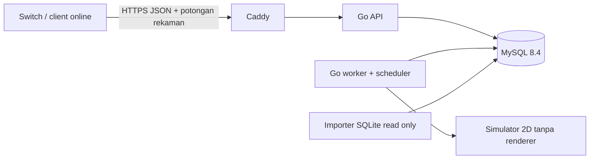

# FootballNX Manager League — kontrak dan rencana backend v1

Tanggal: 28 Oktober 2026. Baseline client: checkpoint `7e3564c` / build v100.
Target implementasi: **Go, MySQL, Docker Compose, VPS Ubuntu 2 CPU / RAM 2 GB**.
Status: spesifikasi implementasi; backend belum dibangun oleh dokumen ini.

**Prioritas revisi terbaru (29 Oktober 2026):** baca
[BACKEND-REVIEW.md](BACKEND-REVIEW.md) dan [hub v112](MANAGER_HUB_V112.md)
terlebih dahulu. v112 menggantikan **seluruh** ketentuan ranking 14 hari,
rumus RP berbasis jumlah peserta, pengaitan period ketika liga dikonfirmasi,
dan pembayaran RP pada Minggu di baseline ini. Aturan aktif adalah bulan
kalender WIB, +500 saat join, tambahan podium 2.000/1.500/1.000 ketika tabel
akhir resmi, dan arsip satu juara tiap bulan. Cash Minggu tetap berlaku.
Bagian ranking/SQL/acceptance baseline di bawah adalah historis jika bertentangan
dengan v112; jangan menjalankan kedua algoritma kredit sekaligus.

Revisi produk 28 Oktober 2026: minimum **4 tim total**; 1–3 pendaftar manusia
ditambah BOT sampai 4 saat pendaftaran tutup. Revisi ini menggantikan minimum8
dan penundaan ke window berikutnya karena kekurangan peserta. Tidak mengubah
hasil/rekaman liga yang sudah dikonfirmasi. Lihat §7 untuk aturan BOT.

Dokumen ini adalah instruksi handoff untuk agent backend. Kerjakan backend,
importer katalog, simulator, tes, serta deployment sesuai kontrak berikut.
Jangan menganggap prototipe lokal Switch sudah merupakan client online.

## 1. Keputusan produk dan batas implementasi

### 1.1 Wajib sesuai arahan pengguna

| Area | Kontrak |
| --- | --- |
| Login | User ID + PIN tepat empat digit; ada Register, Login, Logout |
| Ekonomi | NX Cash terpisah dari League Point dan Ranking Points |
| Saldo awal | 5.000 NX Cash sekali per akun |
| Partisipasi | 1.500 NX Cash sekali untuk setiap liga yang diikuti, termasuk liga pertama |
| Hadiah | Juara 1: 5.000; juara 2: 4.000; juara 3: 3.000; lainnya: 0 tambahan |
| Kalender | W1: Senin pendaftaran+persiapan, Selasa persiapan, Rabu pertandingan. W2: Kamis pendaftaran+persiapan, Jumat persiapan, Sabtu pertandingan. Minggu overview dan pembagian hadiah |
| Minimum dan BOT | Minimum 4 tim total; 1–3 manusia diisi BOT sampai 4 pada registration close, tanpa menunggu week berikutnya; 0 manusia menutup window kosong |
| Ranking | Bulan kalender WIB; +500 partisipasi, podium +2.000/+1.500/+1.000; arsip bulanan dan W1/W2 terpisah. Kontrak v112 mengesampingkan RP legacy di bawah |
| Pack | Lite pilih 2/5, Medium 4/6, Jumbo 5/8 |
| Pembayaran pack | Konfirmasi harga → debit sekali + simpan pool → animasi → pilih pemain → confirm grant |
| Pemulihan pack | Keluar aplikasi/koneksi putus tetap melanjutkan pool berbayar yang sama |
| Save Game Plan | Edit menjadi draft lokal; satu full-plan PUT saat keluar editor jika dirty, tidak setiap ganti posisi/formasi; missing/stale revision ditolak dan draft aman saat gagal |
| Simulasi | **Kekuatan efektif, tanpa undian skor**, sesuai konfirmasi pengguna |
| Penonton | Satu pertandingan resmi dan satu rekaman yang sama untuk semua penonton |
| Durasi | Dua babak, masing-masing lima menit dunia nyata |
| Katalog | SQLite handoff seluruh tim/pemain yang tersedia; server mengimpor ke MySQL |
| Versi | Server online 1.0.0 wajib menolak client online 0.9.0 |
| DEV MODE | Tetap ada Manager League offline untuk mengembangkan fitur; masuk lewat pintasan rahasia di Main Menu, tanpa memerlukan server/internet |
| ONLINEDEV | Satu akun DEV provision operator; login otomatis realm TEST dari server, API nyata dengan demo time dan data terpisah dari PRODUCTION; lihat addendum v106 |
| Promotion CDK | Shop redeem kode sekali pakai untuk5000 NX Cash; durable receipt dan wallet/ledger server, TEST code terpisah dari production |

### 1.2 Default implementasi v1 yang diusulkan

Angka dalam tabel ini adalah pilihan desain v1, bukan klaim sudah disetujui
sebagai hasil balancing. Simpan dalam `ruleset`, jangan sebar sebagai magic number.
Agent dapat mengimplementasikan seluruh alur dengan profil ini; ganti melalui
rilis konfigurasi terversi, tanpa mengubah transaksi atau identitas pemain.

| Parameter | Default v1 |
| --- | --- |
| Peserta grup | 4–16 tim per grup; satu klub per akun manusia, satu entry per liga; BOT hanya mengisi total yang kurang dari4 saat close |
| Format | Single round robin, setiap pasangan sekali, tanpa dua leg |
| Starter | 18 pemain OVR 60–69; 2 GK, 6 DEF, 6 MID, 4 FWD |
| Koleksi / registered squad / match squad | 128 / maksimum 25 / 18, dengan XI tepat 11 |
| Kondisi awal | Reset kebugaran per pertandingan; tidak ada carry-over cedera/suspensi v1 |
| Kondisi laga online | Lapangan normal/kering, cuaca netral tetap pada ruleset v1; tidak mengambil keuntungan dari stadium visual yang dipilih klub |
| Substitusi | Maksimum 3; rencana otomatis dikunci sebelum laga |
| Jeda babak | 60 detik; total siaran 660 detik = 300 + 60 + 300 |
| Jadwal hadiah podium/RP | Minggu09:00 WIB untuk kedua liga pekan tersebut; jam09:00 adalah default usulan, hari Minggu merupakan arahan pengguna |
| Cutoff Game Plan | Lima menit sebelum kickoff |
| Shop | Ditutup untuk peserta selama fase kompetisi; grant pack yang sudah dibayar tetap boleh |
| RP akhir liga | `floor(1000 * (N - rank) / (N - 1))`, tidak dapat dibelanjakan |
| Harga contoh development | Lite 1.000, Medium 2.200, Jumbo 3.000 NX Cash; **bukan harga produksi yang sudah disetujui** |
| Duplikasi | Satu kepemilikan per `player_key` per klub; satu pembelian per offer/account |
| Pack pool | Daftar curated tetap 5/6/8; tidak ada undian pemain setelah pembayaran |
| Batas beta awal | 64 manajer per siklus, 100 penonton bersamaan sebagai target uji, bukan kapasitas yang sudah terbukti |

Release konfigurasi harga/offer produksi harus eksplisit, berisi versi, waktu
aktif dan hasil review balance. Fixture development tidak boleh otomatis menjadi
offer produksi. Slot kalender, RP dan koefisien simulator juga terversi.

Tidak termasuk v1: COM vs COM native/siaran video 3D, GPU/emulator PES di VPS,
transfer P2P, top-up uang asli, pasar lelang, pelatihan pemain, coaching live,
serta admin panel web. User menunda COM vs COM. Jangan menyediakan opsi 3D palsu.

## 2. Hasil kerja agent backend

Backend baru diletakkan di `backend/` atau repository backend terpisah.
Jangan mengubah hook/gameplay/native save Switch saat mengerjakan backend.

```text
backend/
  cmd/fnx-server/              # api | worker | migrate | import-catalog | healthcheck
  internal/{auth,catalog,club,wallet,pack,league,match,ranking,news}/
  internal/{httpapi,mysql,jobs,clock,compatibility}/
  internal/simulator/          # package murni, tidak bergantung HTTP/DB
  api/openapi.yaml            # OpenAPI 3.1, seluruh route + schema di dokumen ini
  api/examples/              # request/response dan rekaman sintetis untuk agent client
  migrations/                # SQL MySQL terversi; bukan AutoMigrate ORM
  simulator-rules/            # koefisien, bobot posisi, golden fixtures
  deploy/{compose.yaml,Dockerfile,my.cnf,Caddyfile,.env.example}
  docs/{RUNBOOK.md,CATALOG-IMPORT.md,SIMULATOR-REPORT.md,CLIENT-INTEGRATION.md}
```

Hasil wajib: backend berjalan, migration/import tervalidasi, OpenAPI tanpa route
placeholder, kontrak contoh yang dapat direplay client, pengujian race/crash,
laporan balancing deterministik, benchmark pada batas 2 CPU/2 GB, backup/restore,
serta daftar batas fitur yang benar-benar belum tersedia. Jangan menulis Go
seolah semua kebutuhan selesai ketika API masih mengembalikan data dummy.

## 3. Arsitektur dan anggaran server



Gunakan satu binary Go dengan subcommand berbeda untuk API dan worker. MySQL
menjadi penyimpan state, ledger, job, outbox dan rekaman. MVP tidak memerlukan
Redis, Kafka, Kubernetes, service discovery atau video encoder. Worker menghitung
rekaman jauh lebih cepat dari durasi tontonan; jangan menunggu 660 detik untuk
menyelesaikan satu job, dan jangan menghitung ulang per penonton.

Target toolchain awal Go 1.27.3, yang tercatat pada release history resmi saat
dokumen disusun. Pin patch serta digest image pada implementasi dan periksa
kembali pembaruan keamanan saat deployment. [Go release history](https://go.dev/doc/devel/release)

| Container | Batas RAM awal | CPU limit | Catatan |
| --- | ---: | ---: | --- |
| API | 256 MiB | 0,4 | `GOMEMLIMIT=192MiB`, `GOMAXPROCS=1`; maksimum dua hash PIN bersamaan |
| Worker | 256 MiB | 0,8 | `GOMEMLIMIT=192MiB`, concurrency simulasi satu |
| MySQL | 768 MiB | 0,6 | Buffer pool awal 256 MiB; pool koneksi aplikasi dibatasi |
| Caddy | 64 MiB | 0,2 | TLS dan reverse proxy |
| Sisa host | Sekitar 700 MiB | — | OS, Docker, filesystem cache dan margin |

Ini anggaran awal, bukan jaminan beban muat. `GOMEMLIMIT` bukan hard limit RSS.
Ukur RSS, OOM, antrean job, CPU, disk dan latensi. API `MaxOpenConns=8`, worker
`MaxOpenConns=4`; tidak boleh membuat goroutine, koneksi, cache atau antrean tanpa batas.
Gunakan `net/http`, `database/sql`, driver MySQL yang dipin; `sqlc` boleh untuk
query bertipe. Tidak perlu ORM yang memuat seluruh katalog ke RAM.

## 4. SQLite katalog handoff dan identitas canonical

### 4.1 Isi folder yang diserahkan

```text
FootballNX-Backend-Handoff-v1/
  BACKEND-PLAN.md
  PLAYER-CATALOG.sqlite
  PLAYER-CATALOG.manifest.json
```

SQLite adalah **seed referensi read-only**, bukan database akun online. Database
operasional tetap MySQL. SQLite tidak berisi saldo, PIN, sesi, maupun daftar
kepemilikan pengguna nyata. Kepemilikan online dibuat server di `player_instances`.

Katalog diekspor dari selector/roster v100 yang benar-benar dipasangkan dengan
CPK aktif. Jangan mengambil scope dari arsip wide master 443 tim. Snapshot ini:

| Isi | Jumlah |
| --- | ---: |
| Kategori | 27 |
| Tim | 394: 306 klub dan 88 timnas |
| Klub sumber pack yang eligible | 304; dua klub kategori WORLD dikecualikan dari pack v1 |
| Pemain unik | 10.433 |
| Keanggotaan tim | 11.408; pemain klub/timnas tetap satu identitas |
| Atribut native | 25 per pemain, total 260.825 baris |
| Binding runtime | 10.433 |
| Anggota katalog Manager lokal | 9.075 |
| Identitas | 10.101 `ef:*`, 332 `fl26:*` |
| Pemain starter OVR 60–69 | 4.810, tetap perlu validasi distribusi posisi |

Identitas snapshot:

```text
catalog_version:             1.0.0
catalog_content_sha256:      2ffab2858daa681400e89445d75c28c0d8ac951bd36b0ec4af35ff08020f1222
sqlite_file_sha256:          1678985ae3ee1e16da193fdd7356768bc690ac40a8a2f62fad11bfd8d0f8a826
sqlite_bytes:               29843456
runtime_pair_id:             e861c583ec78e9ae
manager_catalog_content_id:  97e84d7f8c21ba930bb0e13793ac46c91a60836a33902d40100d36aa5801a59f
source_client_checkpoint:    7e3564c6b8300fa4aefd55e75de537f3742d4643
```

Hash konten logis berbeda dari hash file SQLite. Hash logis berasal dari JSON
UTF-8 dengan key objek terurut, separator `,`/`:`, tanpa whitespace, Unicode asli,
atas enam dataset `categories`, `teams`, `players`, `player_attributes`,
`team_memberships`, `runtime_bindings`; urutan baris seperti exporter proyek.
Metadata dan detail penyimpanan SQLite tidak masuk hash konten logis.

`player_key` adalah referensi lintas sistem: contoh `ef:134931`. Untuk identitas
eFootball, BaseId adalah master ID. NativePES21Id adalah storage/asset binding,
bukan identitas utama. Pemain FL26 tanpa BaseId terverifikasi menggunakan
`fl26:<pc_id>`, dengan `ef_base_id=NULL`; jangan mengarang BaseId. Nilai bridge
runtime lama `0x80000000 | pc_id` disimpan pada `runtime_identity`, bukan BaseId.

Jangan menduplikasi pemain karena timnas, pindah klub, kartu, atau variasi pack.
Pemain yang sama dapat dimiliki akun berbeda melalui instance kepemilikan
berbeda. `native_player_id` tidak pernah menjadi kunci transaksi pack.

### 4.2 Schema SQLite yang benar-benar disertakan

| Tabel/view | Kontrak |
| --- | --- |
| `metadata` | Key/value: versi, hash, pair ID, provenance hash; tanpa path mesin pribadi |
| `categories` | `category_key` PK, display name, urutan |
| `teams` | Logical team ID, native physical ID unik, nama, kind, kategori, badge slot, pack eligibility |
| `players` | `player_key` PK, namespace/source ID, BaseId nullable, bridge ID, native ID, nama, posisi, OVR, fingerprint |
| `player_attributes` | PK `(player_key, attribute_key)`, raw 40–103, normalisasi basis point 0–10000, sumber |
| `team_memberships` | PK `(team_id, player_key)`, urutan roster, nomor baju, jenis membership |
| `runtime_bindings` | Referensi runtime/portrait; tidak menyalin asset; face/commentary owner yang tidak diaudit tetap NULL |
| `v_team_rosters` | Join tim, membership dan pemain untuk inspeksi |
| `v_pack_candidates` | Hanya membership klub yang `pack_eligible=1` |

`display_ovr` mengikuti override roster yang dipakai UI bila tersedia; fallback
FL26 memakai rata-rata atribut posisi yang terversi. Itu bukan klaim OVR native.
`native_role_strength` dan 25 atribut adalah nilai lain, jangan disamakan dengan
display OVR. Profil usia/tinggi/berat/country dari referensi lama hanya diisi jika
BaseId, native ID, nama ternormalisasi dan posisi cocok; lainnya NULL. Umur adalah
umur referensi snapshot, bukan usia real-time. Jangan mengisi data hilang dengan
profil donor. Asset binding tidak memberi izin mewariskan face/commentary.

Contoh inspeksi read-only:

```sql
SELECT team_id, display_name, kind, pack_eligible FROM teams ORDER BY team_id;
SELECT player_key, display_name, position, display_ovr, shirt_number
  FROM v_team_rosters WHERE team_id=108 ORDER BY roster_order;
SELECT * FROM player_attributes WHERE player_key='ef:134931';
SELECT player_key, COUNT(*) FROM team_memberships GROUP BY player_key HAVING COUNT(*)>1;
PRAGMA integrity_check;
PRAGMA foreign_key_check;
```

### 4.3 Kontrak importer SQLite → MySQL

1. Terima file dan manifest dari operator, bukan upload bebas dari client.
   Buka SQLite URI `mode=ro`, tanpa menjalankan extension atau SQL dari metadata.
2. Cocokkan SHA256 seluruh file dengan manifest; `integrity_check=ok`, tidak ada
   FK violation; periksa schema version, jumlah baris, keunikan ID dan 25 atribut.
3. Hitung ulang hash konten logis. Verifikasi runtime pair, binding dan daftar
   tim persis. Tidak boleh mengambil 16 kandidat scorer sebagai seluruh roster.
4. Impor ke release MySQL berstatus `STAGING` dengan prepared statement/batch
   maksimum 500 baris. Ulangi import hash sama harus no-op, bukan release baru.
5. Bandingkan seluruh key, nilai atribut, membership, OVR, namespace dan hash
   per pemain setelah round-trip MySQL. Counts saja tidak cukup.
6. Jadikan `READY` hanya setelah validasi penuh. Ubah pointer release aktif pada
   transaksi singkat; jangan membiarkan client melihat import setengah jadi.
7. Offer dan pendaftaran baru memakai release aktif; entry liga, instance
   kepemilikan dan match snapshot lama tetap merujuk release asal yang immutable.
8. Perubahan BaseId mapping/fingerprint ditahan sebagai konflik, bukan donor
   otomatis. Rilis data tidak menghapus pemain milik akun. Pemain deprecated
   tetap dapat dibaca dari versi asal; eligibility masa depan dinyatakan eksplisit.

Katalog server/client yang tidak cocok memblokir mutation online, bukan
menormalkan ID secara diam-diam. File SQLite dan data turunan game tetap lokal /
private dan ignored; hanya MD, schema, alat exporter dan tes sintetis boleh
masuk repository publik. Jangan mengunggah APK, OBB, CPK, PAK atau asset native.

## 5. Version gate online

Pisahkan `backend_release_version` (deployment Go) dari
`required_online_version` (kontrak client). MVP memakai kecocokan **exact** untuk
versi online, bukan perbandingan string atau menerima semua versi lebih baru.
Patch internal backend boleh tidak mengubah kontrak online.

| Server required online | Client online | Hasil |
| --- | --- | --- |
| 1.0.0 | 0.9.0 | Blokir online, HTTP 426 `CLIENT_UPDATE_REQUIRED` |
| 1.0.0 | hilang/tidak valid | Blokir online, HTTP 426 |
| 1.0.0 | 1.0.0 + katalog/binding cocok | Boleh lanjut login/admission |
| 1.0.0 | 1.0.0 + katalog berbeda | HTTP 409 `CATALOG_SYNC_REQUIRED`; bila perlu NRO baru, arahkan update |
| 1.0.0 | 1.1.0/prerelease | HTTP 426 `CLIENT_VERSION_UNSUPPORTED` sampai server mendukungnya |

Versi online bukan nomor build v100 atau versi PES Mobile. Client v100 saat ini
belum memiliki adapter online; jangan menambahkannya ke allowlist hanya karena
SQLite berasal dari v100. Rilis client terintegrasi harus mengiklankan kontrak
1.0.0 dan kemampuan durasi/rekaman yang dijelaskan di sini.

`GET /api/v1/compatibility` boleh tanpa autentikasi dan tanpa header versi.
Kembalikan `backend_release_version`, `required_online_version`,
`required_catalog_version`, `required_catalog_content_sha256`,
`required_runtime_pair_id`, `api_schema_version`, `minimum_client_build_policy`,
`maintenance`, `server_now_ms`, `update_url`, dan `reason` kompatibilitas.
Build yang diterima dicatat dalam allowlist release operator, bukan angka
build yang dikarang client. URL update HTTPS berasal dari konfigurasi operator.

Semua route aplikasi lain, termasuk register/login/refresh, menjalankan gate
sebelum handler. Header wajib:

```http
X-FNX-Online-Version: 1.0.0
X-FNX-Catalog-Hash: 2ffab2858daa681400e89445d75c28c0d8ac951bd36b0ec4af35ff08020f1222
X-FNX-Client-Build: <build-id rilis client online yang diizinkan>
X-FNX-API-Schema: 1
Authorization: Bearer <access-token>   # hanya route authenticated
```

Sesi lama tidak melewati gate; perubahan requirement memblokir request berikutnya.
Mode offline tetap dapat dimainkan. Logout/revoke menggunakan route gate-exempt
terbatas agar client lama dapat mencabut sesi; tidak mengembalikan data game.
Sesi tidak pernah memberi hak mengirim hasil pertandingan atau saldo. Header
versi dapat dipalsukan client modifikasi: gate adalah kontrol kompatibilitas,
bukan bukti integritas binary atau anticheat.

## 6. Akun, PIN, sesi dan otorisasi

- User ID ASCII lowercase `[a-z0-9._]{3,24}`; normalisasi sebelum lookup/unique.
  PIN adalah string `^[0-9]{4}$`, sehingga `0042` valid dan tidak berubah menjadi 42.
- Club name 3–31 byte UTF-8, tanpa control character. Identitas visual tim tidak
  memberikan roster klub aslinya. Register membuat akun/klub sekali, starter
  sekali, wallet +5.000 sekali, dalam satu transaksi idempoten.
- Starter dipilih server dari katalog OVR 60–69 sesuai distribusi posisi dan
  budget kekuatan XI setara; simpan daftar final. Retry tidak memberi reroll.
  Pengacakan onboarding/grouping diperbolehkan; larangan RNG berlaku pada laga.
- Jangan membawa verifier PIN lokal prototipe menjadi autentikasi server.
  Gunakan Argon2id, salt acak per akun, pepper terpisah dari database. Default
  proyek: 32 MiB, 3 iterasi, parallelism 1, output 32 byte; benchmark concurrency
  dua. Simpan format/version parameter, bukan plaintext PIN. Empat digit hanya
  10.000 kombinasi; hashing tidak menggantikan pembatasan tebakan online.
  [OWASP penyimpanan kredensial](https://cheatsheetseries.owasp.org/cheatsheets/Password_Storage_Cheat_Sheet.html),
  [Go Argon2id](https://pkg.go.dev/golang.org/x/crypto/argon2)
- Input Argon2id adalah HMAC-SHA256(pepper, domain+normalized_user_id+PIN), dengan
  encoding length-prefix yang tetap, salt acak16byte per akun, dan verifier
  constant-time. PHC verifier memuat parameter/salt/output; pepper version terpisah.
  Pepper/request-HMAC/retry-encryption key berbeda dan terversi. Rotasi key
  menyimpan versi lama sampai rehash/login atau reset, tidak membuat akun buntu.
- Pembatasan persisten per akun: lima kegagalan/15 menit → cooldown 15 menit;
  pengulangan blok menaikkan cooldown sampai 24 jam. Per IP: 20 kegagalan/15
  menit; global concurrency hash dua, antrean pendek maksimum delapan. Hitung
  percobaan secara atomik sebelum hash. Username tidak ditemukan tetap memakai
  jalur respons login generik; jangan mengungkap apakah PIN atau user ID salah.
- Rate bucket akun berdasarkan HMAC user ID, tidak dihapus hanya dengan restart.
  IP bukan bukti satu manusia; jangan otomatis melarang keluarga satu jaringan.
  Log tanpa PIN/token/raw request body. TLS wajib. Default ini perlu uji abuse;
  empat digit tidak menjamin kebal brute-force. [OWASP autentikasi](https://cheatsheetseries.owasp.org/cheatsheets/Authentication_Cheat_Sheet.html)
- Access token opaque acak 256 bit, TTL 15 menit; refresh opaque 256 bit, TTL
  30 hari, maksimum tiga sesi aktif. Database menyimpan SHA256 token, bukan
  token asli. Refresh dirotasi atomik; penggunaan ulang di luar retry grace
  mencabut family. Satu client menjalankan refresh single-flight.
- Retry refresh memakai key yang sama: cache respons terenkripsi AES-GCM selama
  60 detik, terikat hash token lama + key + hash payload. Jangan menyimpan
  token plaintext dalam tabel idempotency biasa. Setelah grace, login lagi.
- Refresh family mempunyai batas absolut30hari sejak login, bukan diperpanjang
  tanpa batas setiap refresh. Change-PIN menaikkan credential_version, mencabut
  sesi lain dan memperbarui credential_version sesi current secara atomik;
  recovery mencabut semuanya. State check selalu diperiksa saat autentikasi.
- Beri recovery code acak minimal 128 bit sekali saat onboarding / login pertama
  yang belum mengambilnya; simpan hash. Recovery memerlukan code dan PIN baru,
  mengonsumsi code, merotasi recovery code serta mencabut seluruh sesi. Jangan
  mereset PIN hanya dari user ID, device ID, nickname atau IP.
- Logout mencabut sesi saat ini; logout-all/recovery/change-PIN mencabut seluruh
  family yang dipilih. Credit wallet tidak terkait sesi atau perangkat.
- Semua mutation memakai account dari access token, bukan `account_id` body.
  ID objek milik orang lain mengembalikan 404/403 konsisten. Data opponent yang
  boleh publik tidak mencakup wallet, PIN, token, recovery atau koleksi privat.

Beta boleh memakai invite/admission untuk menahan multi-account farming.
Jangan mengklaim device ID client dapat membuktikan satu manusia atau konsol asli.
Default usulan profil beta memakai invite sekali pakai yang dibuat operator;
Register dan recovery dibatasi juga sebelum pekerjaan hash, default5 request/
jam/IP pada beta, dengan error429 generik. Invite tidak masuk NRO. Endpoint
read memiliki budget per session/account dan batas request in-flight global;
tetapkan sesuai load test streaming, jangan memakai throttle login untuk chunk.
`registration_invite_required` adalah setting operator; request invite optional
pada schema karena dapat dimatikan di development, tetapi wajib bila setting ON.

## 7. Kalender, minimum4, BOT, grup dan hadiah Minggu

Waktu otoritatif server disimpan UTC `DATETIME(3)`; UI menggunakan Asia/Jakarta.
Jam perangkat, `Y DEMO TIME`, serta tombol NEXT LEAGUE tidak mengubah jam produksi.
Dev clock lokal hanya untuk DEV offline. ONLINEDEV memakai akun TEST yang
diotorisasi server dan route clock TEST pada [addendum v106](MANAGER_ONLINEDEV_CDK_V106.md);
token production selalu ditolak. Satu minggu nyata mempunyai **dua kesempatan liga**, W1 dan W2;
window tanpa pendaftar tidak membuat liga; window dengan minimal satu manusia
memakai autofill sampai empat tim dan tetap bermain pada match day window itu.

| Hari nyata | Waktu/phase dan aksi |
| --- | --- |
| Senin | W1 REGISTRATION_PREPARATION, pendaftaran00:00–24:00 dan persiapan |
| Selasa | W1 PREPARATION saja; tidak menerima pendaftar baru. Shop/squad/Game Plan dapat dipersiapkan, BOT kekurangan slot sudah dibuat saat close |
| Rabu | W1 MATCH_DAY saja; seluruh round liga W1 disiarkan hari ini |
| Kamis | W2 REGISTRATION_PREPARATION00:00–24:00 untuk liga baru; cohort legacy waiting hanya dimigrasikan sekali sesuai §7.1 |
| Jumat | W2 PREPARATION saja; tidak menerima pendaftar baru |
| Sabtu | W2 MATCH_DAY saja; seluruh round liga W2 disiarkan hari ini |
| Minggu | RESULT_OVERVIEW dan pembayaran podium/RP kedua liga; tidak ada pendaftaran/fixture normal |

### 7.1 Pendaftaran, minimum4 dan autofill BOT

Window pendaftaran Senin `[Senin00:00,Selasa00:00)`; Kamis
`[Kamis00:00,Jumat00:00)`. End eksklusif. Join dan close memakai lock window+
cycle yang sama dan mengecek waktu DB sesudah memperoleh lock. Request setelah
cutoff ditolak walaupun mulai dikirim sebelum cutoff.
Jadwal ini mengatur **Join League**, bukan Register akun: akun dapat dibuat
kapan saja dan memperoleh starting wallet5000 sekali; bonus1500 baru diberikan
ketika Join pada window yang sah. Peserta tetap dapat mengurus shop,
koleksi dan Game Plan; pendaftaran peserta baru hanya Senin/Kamis.

Tunggu penutupan window walaupun minimum sudah tercapai. Dengan H manusia yang
sah saat close, gunakan `B = max(0,4-H)` untuk H>=1. H=1/2/3 menjadi total4
dengan BOT3/2/1; H>=4 tidak perlu BOT. **Tidak carry karena kurang peserta.**
Jika H=0, tutup `CLOSED_EMPTY`/cycle `CANCELLED_EMPTY`, tanpa BOT/fixture/hadiah;
window berikutnya dapat membuka liga baru. Cap64 berlaku untuk manusia; total
setelah autofill maksimal64. Tidak membuka Join Selasa/Jumat.

Dalam satu transaksi close: lock registration scope/window/cycle yang sama
dengan Join, hitung manusia committed, buat BOT/club/roster/plan/entry yang
diperlukan, konfirmasi period, kelompok dan jadwal. Unique `(cycle_id,bot_slot)`
dan fixture/group constraints menjaga retry/restart worker tetap idempoten.
BOT baru tidak ditambah sesudah jadwal committed dan tidak mengganti manusia
yang sedang offline. Registration close bukan kickoff; preparation tetap ada.

BOT memiliki klub dan owned instances canonical dengan `owner_kind=BOT`, bukan
akun login. Gunakan 18 pemain dari catalog yang dikunci dan plan legal satu GK
di XI; default profil OVR60–69 setara baseline starter, ruleset/profile version
dan snapshot disimpan. Pembentukan roster reproducible dari cycle+bot_slot+
ruleset dan daftar canonical tersortir; tidak mengundi skor atau menaikkan
strength saat lawan manusia lebih kuat. Simulator memakai jalur yang sama.

`entry_kind=HUMAN|BOT` dan `is_bot` terlihat di profile, gameplan, standings,
schedule, news, recording/header dan honours. BOT tidak memiliki PIN/session,
wallet, shop/pack, bonus1500, cash award atau Overall Rank akun. Default ekonomi:
posisi akhir campuran tetap resmi; BOT podium tidak membuat manusia di bawahnya
naik penerima hadiah. Human rank2 tetap4000, human rank4 tidak mendapat cash
podium; BOT menang tetap tercatat sebagai BOT pada previous champions.
RP manusia memakai rank dan N total termasuk BOT pada rumus §1.2.

Bootstrap/Calendar: `minimum_entries=4`, `autofill_policy=FILL_TO_MINIMUM_AT_CLOSE`,
`human_entry_count`, `bot_entry_count`, `total_entry_count`, `bot_slots_if_closed_now`,
`registration_window_id`, `registration_closes_at_ms`, `confirmed_match_day` dan
`next_registration_at`. Prediksi bot_slots bukan BOT yang sudah dibuat. Alias
waiting_entry_count berarti manusia saat OPEN; jangan tetap mengiklankan perlu8.
UI misalnya "3 pemain — 1 BOT akan melengkapi liga saat pendaftaran ditutup".

Migrasi legacy saja: cohort `WAITING_NEXT_WINDOW` yang sudah ada dipasang ke
window sah berikutnya sebelum menerima Join; pertahankan cycle/entry dan ledger
bonus manusia. Saat close, autofill aturan baru; tidak ada bonus1500 ulang.
Kolom carry lama boleh tetap nullable/0 untuk audit, bukan kebijakan aktif.
Tidak mereset wallet/ownership/pending atau meregenerasi fixture yang sudah
confirmed/sealed. Window baru selanjutnya memakai cycle baru. Versikan aturan
dan schema; jangan mengubah catalog/ruleset liga yang sudah locked.

### 7.2 Persiapan, roster lock dan pertandingan satu hari

Untuk N>=4 sesudah autofill gunakan `k=ceil(N/16)` dan ukuran `floor(N/k)`/`ceil(N/k)`.
Contoh4→4, 5→5, 17→8+9; seluruh grup4..16, tanpa leftover grup kurang4. Pengelompokan
dan urutan tiebreak dikunci setelah registration close. Jadwal sudah boleh
dibaca pada hari persiapan, tetapi registered squad masih boleh diperbarui.

Roster kompetisi dikunci **Rabu00:00 untuk W1 / Sabtu00:00 untuk W2**, sesudah
hari preparation penuh. Shop/squad registration ditutup untuk peserta mulai
roster lock sampai match day selesai; receipt berbayar tetap dapat di-grant.
XI/Game Plan dari roster yang terkunci boleh direvisi sampai cutoff setiap
round, lima menit sebelum kickoff. Round selanjutnya tidak dikunci sebelum
round sebelumnya resmi selesai. Tidak mengunci roster sejak Senin close lalu
menghilangkan kesempatan persiapan Selasa.

Single round robin: N(N−1)/2 fixture; R=N−1 bila genap dan R=N bila ganjil.
Bye bukan fixture dan tidak mendapat poin/gol. Setiap tim bermain N−1 kali;
selisih jumlah home/away maksimum satu, setiap pasangan tepat sekali.
**Semua round dimainkan Rabu atau Sabtu**, tidak dibagi ke Selasa/Jumat.

Default usulan slot45menit dari12:00 WIB: `kickoff(r)=12:00+(r−1)*45menit`,
untuk r1..R. Grup4 membutuhkan3round/6fixture, grup8 membutuhkan7round;
grup15/16 membutuhkan15round, terakhir
22:30 dan selesai22:41 (durasi660detik). Slot ini menyediakan jarak untuk
publish/recovery dan cutoff round berikut; tiap tim tidak bertanding paralel.
Jika jadwal harus DELAYED, reschedule hanya round belum terkunci; jangan
memaksakan match palsu atau diam-diam melewati Sunday payout. Bila insiden
menggeser laga ke hari lain, tampilkan status penundaan/insiden secara eksplisit.

Tidak ada revisi penonton yang mengubah match SEALED. Offline/login gagal bukan
WO. Klub yang keluar setelah lock tetap memakai plan valid terakhir. Jika plan
terakhir tidak valid, gunakan fallback legal yang telah disimpan dan beri
alasan; tidak menciptakan pemain cadangan atau donor.

State liga: `REGISTRATION → PREPARATION → ROSTER_LOCKED → COMPETITION →
RESULTS_READY → SETTLING → CLOSED`; cabang kosong `REGISTRATION → CANCELLED_EMPTY`
dan insiden `SUSPENDED`. WAITING_NEXT_WINDOW hanya legacy migration §7.1. State fixture
internal `SCHEDULED → LOCKED → COMPUTING → SEALED`; state publik
`SCHEDULED / DELAYED / LIVE / ENDED` dari kesiapan rekaman dan waktu siaran.

### 7.3 Overview dan pembayaran hari Minggu

Klasemen3/1/0; tie-break poin, GD, GF, mini-table tim masih seri (poin/GD/GF,
tanpa rekursi), lalu urutan yang dikomit sebelum kompetisi. Usia account ID
tidak memberi keuntungan. Setelah semua fixture grup resmi ENDED, final table
dan podium preview dapat dibaca, state `RESULTS_READY`; **hadiah belum dibayar**.

Default usulan payout **Minggu09:00 WIB** untuk W1 Rabu dan W2 Sabtu pekan yang
sama. Kontrak hari Minggu wajib; jam09:00 terversi/configurable. API rewards
memuat `awards_available_at_ms`, `status=PENDING_SUNDAY/READY/SETTLED/DELAYED`,
entitlement per akun, cash/RP amounts dan settled_at nullable. GET tidak membayar.
Saldo awal5000 dan bonus join1500 tetap dibayar saat aksi tersebut sah; yang
menunggu Minggu adalah podium5000/4000/3000 serta RP akhir liga.

Settlement hanya setelah **waktu payout tercapai DAN semua fixture grup ENDED
dan published**. Dalam satu transaksi grup: validasi final table, ledger hadiah,
RP, champion archive dan outbox. Jika gagal rollback seluruh grup. Group lain
yang telah siap tidak perlu menunggu group insiden. Grup terlambat dibayar
sekali ketika hasil resmi lengkap setelah payout, dengan status DELAYED;
tidak mengarang pemenang dan tidak otomatis membatalkan hadiah. BOT tidak mendapat
ledger cash/RP akun atau competition_awards; manusia mengikuti rank campuran
sebenarnya. Window kosong tidak memiliki entitlement. Snapshot honours tetap
mencatat BOT dan `entry_kind` jika BOT memenangkan liga.

Ranking period berjangkar Senin **26 Oktober2026 00:00 WIB**, interval14hari
`[start,end)`. Period ditautkan **ketika window berhasil mengonfirmasi liga**,
bukan saat pertama bergabung (termasuk cohort waiting legacy sebelum migrasi).
Sebelum confirmed, ranking_period_id liga NULL. Setelah confirmed, period_id tetap;
settlement terlambat masuk period asal, bukan period baru. Reset period tetap
tepat waktu tanpa menghapus wallet/players/honours; period lama PROVISIONAL
bila masih ada hasil/hadiah tertunda. Overall Rank mengurutkan RP desc, gelar
period desc, wins desc, GD desc, lalu committed draw order.

### 7.4 Contoh kalender yang harus menjadi fixture kontrak

| Skenario | Hasil yang wajib |
| --- | --- |
| Senin26Okt2026 tutup dengan8 tim | Selasa27 persiapan; Rabu28 seluruh7round untuk grup8; hasil resmi terlihat Rabu, podium/RP dibayar Minggu1Nov sesuai payout time |
| Senin26 tutup dengan3 manusia | Tambah1BOT atomik, Selasa persiapan, Rabu28 main6fixture/3round; tidak menunggu Kamis; Minggu hadiah hanya manusia menurut rank akhir |
| Senin26 tutup dengan1/2/4/5 manusia | Masing-masing tambah3/2/0/0 BOT; ukuran akhir4/4/4/5; untuk5tim ada5round dengan bye sah |
| Senin26 tutup tanpa pendaftar | CLOSED_EMPTY, tanpa BOT/fixture/award; Kamis29 membuka window/cycle baru |
| Senin26 cukup8, Kamis29 membuka liga baru | Dua logical cycle berbeda; peserta boleh ikut keduanya dan menerima1500 sekali pada masing-masing liga; Minggu1Nov settlement kedua liga secara terpisah, tidak menyatukan podium |
| Cohort legacy3manusia WAITING sebelum rilis aturan baru | Pada window sah berikut, entry/ledger manusia tetap; saat close tambah1BOT sekali, tetapkan period window konfirmasi, tanpa bonus ulang |
| Liga Sabtu7Nov terlambat selesai setelah reset9Nov | Period tetap period konfirmasi awal; hadiah/RP dibayar sekali setelah semua result resmi, period lama PROVISIONAL sampai selesai; tidak memasukkan RP liga lama ke ranking baru |

Tanggal/phase contoh di atas memakai WIB; test vectors backend juga memuat
epoch UTC ekuivalen. Saat Sunday overview, tampilkan kedua liga yang dimainkan
beserta reward status dan cohort tunggu bila ada; jangan menampilkan gelar untuk
slot yang tidak pernah mulai.

## 8. Ekonomi dan pack: batas transaksi

### 8.1 Wallet dan idempotency

Saldo berupa integer signed 64 bit, satuan NX Cash, tanpa float. Setiap perubahan
punya entry ledger append-only dan `operation_key` unik. Contoh:
`onboarding:<account>`, `entry:<cycle>:<account>`, `pack:<purchase>:debit`,
`podium:<group>:<entry>`. Balance sesudah transaksi harus sama dengan total ledger.

Semua mutation uang/roster/plan/join/pack memakai `Idempotency-Key` UUID yang
dibuat client **sebelum** request dan disimpan sampai hasilnya diketahui.
Scope `(account, operation, key)`, hash canonical payload terikat operation.
Untuk payload kredensial (Register/PIN/recovery/refresh), fingerprint request
memakai **HMAC-SHA256** dengan key server khusus, bukan SHA256 cepat atas PIN
empat digit yang bisa ditebak dari dump database. Jangan menyimpan body sensitif.
Key sama+payload sama mengembalikan respons komit yang sama; payload berbeda
→ 409 `IDEMPOTENCY_KEY_REUSED`. Key baru tidak melewati unique business key.
Ledger/business dedupe dipertahankan permanen; cache response financial minimum
400 hari. Generic cache tidak boleh menyimpan PIN, access atau refresh token.

Lock order global: registration window → cycle → account/club rows (urut ID) → wallet →
purchase → ownership/roster. Job claim lease tidak ditahan sambil menghitung.
Transaksi MySQL pendek; gunakan READ COMMITTED untuk transaksi aplikasi,
explicit `SELECT … FOR UPDATE`, unique key dan retry deadlock maksimal tiga
kali dengan key/payload yang sama. Locking reads/`SKIP LOCKED` adalah kemampuan
InnoDB; skip-locked hanya untuk antrean, bukan perhitungan saldo yang boleh
melewatkan baris. [MySQL locking reads](https://dev.mysql.com/doc/refman/8.4/en/innodb-locking-reads.html)

### 8.2 State pack dan crash recovery

```text
offer dibaca → popup konfirmasi pembayaran → POST purchase
  transaksi: validate + debit + immutable pool + ledger + receipt
  → PAID_PENDING_SELECTION → animasi client → PUT selection
  → POST grant → GRANTED
```

Tidak ada status cancel bagi pack yang sudah dibayar. Logout/menutup aplikasi
tetap boleh; hak milik pending tidak hilang. `GET /me/bootstrap` mengembalikan
`resume_action=COMPLETE_PACK_SELECTION`; Shop juga langsung memulihkan pending.
Satu account maksimum satu paid pending purchase, dibuktikan unique constraint.

Transaksi purchase memeriksa owner, window, eligibility, catalog/offer version,
harga yang dilihat user, saldo, limit, pool unik, kebijakan duplikasi dan kapasitas.
Pool curated adalah daftar tetap 5/6/8 `player_key` + versi; pool tidak dapat
dibaca sebelum debit oleh endpoint katalog. Jika pemain sudah dimiliki membuat
pool tidak memenuhi kontrak, tolak offer **sebelum debit**, jangan mengganti
pemain diam-diam. Harga berubah → 409 `OFFER_CHANGED`, tampilkan konfirmasi baru.

Reserve kapasitas sebanyak draw_count saat purchase. Sambil pending, mutation
koleksi lain yang menghabiskan reservasi ditolak. Selection autosave hanya
menerima subset unik dari pool tersebut dan expected selection revision.
`grant` hanya menerima jumlah tepat draw_count; buat instance unik, tutup receipt
dan publish news dalam satu transaksi. Tidak ada debit kedua dan tidak ada
pengundian ulang. Retry/new key setelah GRANTED mengembalikan receipt yang sama.

Selection/grant purchase yang sudah PAID tetap berjalan ketika offer kedaluwarsa
atau Match Day mulai. Snapshot kompetisi tidak berubah; pemain baru masuk
koleksi, bukan otomatis masuk XI yang sudah dikunci. Gangguan DB mempertahankan
hak pilihan. Refund administratif adalah transaksi kompensasi tersendiri,
tidak menghapus ledger. Pending tidak di-expire atau di-refund otomatis.

## 9. Konvensi HTTP dan daftar endpoint

Base `/api/v1`; HTTPS, JSON UTF-8, ID database sebagai **string desimal**,
`player_key` sebagai string namespace. Epoch ms nonnegatif UTC; boolean JSON
asli; uang integer; null untuk unknown, bukan 0 karangan. Pagination cursor
opaque stabil, default 20, maksimum 100; whitelist sort/filter. Request body
normal maksimum 64 KiB, deadline 5 detik; endpoint rekaman terpisah.

```json
{"data":{},"meta":{"request_id":"req_opaque","server_now_ms":1793116800000,"online_version":"1.0.0","api_schema_version":1}}
```

Error, tanpa stack trace atau debug text:

```json
{"error":{"code":"CLIENT_UPDATE_REQUIRED","message":"Update FootballNX untuk memakai mode online.","retryable":false,"details":{"required_online_version":"1.0.0","update_url":"https://example.invalid/releases/online-1.0.0"}},"meta":{"request_id":"req_opaque","server_now_ms":1793116800000,"online_version":"1.0.0","api_schema_version":1}}
```

Kode status: 400 invalid input; 401 login/token; 403 forbidden; 404 resource;
409 state/version/idempotency conflict; 422 plan/subset tidak sah; 426 upgrade;
429 rate limit + `Retry-After`; 503 maintenance/busy. Timeout client tidak
membuktikan transaksi rollback. Client query receipt dengan key yang sama.

`Idempotency-Key` wajib pada route bertanda **I**. `If-Match`/expected revision
wajib pada **R**. Route **A** perlu access token. Semua, kecuali compatibility,
health dan revoke terbatas, menjalankan version gate. Auth tidak memakai cookie.

| Method + path | Flag | Request / response utama |
| --- | --- | --- |
| GET `/compatibility` | — | Versi client/hash/build opsional query → Compatibility |
| POST `/auth/register` | I | user_id, pin, club_name, presentation_team_id, catalog_hash, invite optional → account/club IDs; login terpisah |
| POST `/auth/login` | — | user_id, pin, device_label → TokenPair, requires_recovery_code_claim |
| POST `/auth/refresh` | I | refresh_token → TokenPair; aturan encrypted retry cache khusus |
| POST `/auth/logout` | A | revoke sesi sekarang; gate-exempt, tidak mengeluarkan data game |
| POST `/auth/logout-all` | A | revoke semua sesi; gate-exempt |
| POST `/auth/recovery-code/claim` | A,I | current_pin → code satu kali; respons sensitif tidak masuk generic cache |
| POST `/auth/recover` | — | user_id, recovery_code, new_pin → reset; ambil code baru setelah login |
| PUT `/me/pin` | A,I | current_pin,new_pin → success + cabut sesi lain |
| GET `/me/bootstrap` | A | Account, wallet, club, cycle/entry, pending pack, versions, menu capabilities |
| GET `/catalog/manifest` | A | CatalogManifest tanpa daftar pemain pool tersembunyi |
| GET `/catalog/teams` | A | category/kind/pack_eligible/cursor → Team[] |
| GET `/catalog/teams/{id}/players` | A | catalog_version/cursor → Player[] + Membership[] |
| GET `/catalog/players/{player_key}` | A | PlayerProfile, seluruh 25 atribut, sumber/versi |
| GET `/me/club` | A | ClubProfile, League Point, RP, history/reward link; NX Cash terpisah |
| PATCH `/me/club` | A,I,R | club_name/presentation_team_id → ClubProfile; tidak memberi roster/bonus baru |
| GET `/me/collection` | A | OwnedPlayer[] terpaginasikan; acquired/current catalog, registered flag |
| GET `/me/squad` | A | RegisteredSquad revision, jumlah 18–25, 11 starter+bench di plan |
| PUT `/me/squad` | A,I,R | daftar instance IDs + expected revision → RegisteredSquad |
| GET `/me/gameplan` | A | current GamePlan + revision + last public snapshot |
| PUT `/me/gameplan` | A,I,R | Seluruh GamePlan + expected_revision wajib + roster_revision, satu Save saat keluar editor dirty → saved plan/revision/hash; control fields tidak masuk plan snapshot |
| GET `/me/gameplan/presets` | A | tiga preset bernama dan current slot |
| PUT `/me/gameplan/presets/{slot}` | A,I,R | slot 0–2, nama, GamePlan; current disimpan di route terpisah |
| POST `/me/gameplan/presets/{slot}/apply` | A,I,R | Explicit standalone publish preset, bila dipakai; editor memuat preset ke draft lokal lalu Save penuh saat keluar, tidak memanggil apply per pilihan |
| GET `/me/wallet` | A | nx_cash, wallet_version |
| GET `/me/wallet/entries` | A | WalletEntry[] newest first |
| GET `/shop/offers` | A | PackOffer[] metadata tanpa pool/player identities |
| GET `/shop/offers/{id}` | A | PackOffer metadata + eligibility + alasan |
| POST `/shop/purchases` | A,I | offer_id, offer_version, accepted_price_nx_cash → PaidPurchase + wallet |
| GET `/me/purchases/pending` | A | PaidPurchase atau null |
| GET `/me/purchases/{id}` | A | Receipt milik akun; pool hanya jika sudah dibayar |
| PUT `/me/purchases/{id}/selection` | A,I,R | selected_player_keys[], selection_revision → PaidPurchase |
| POST `/me/purchases/{id}/grant` | A,I,R | selected_player_keys[], selection_revision → GrantedReceipt |
| GET `/leagues/current` | A | Cycle saat ini/berikutnya, phase, registration, calendar |
| GET `/leagues/registration-windows` | A | Window W1/W2/current/next, minimum4, human/bot/total counts, prediksi BOT saat close, policy autofill dan deadline; bukan membuat entry baru |
| GET `/leagues/{cycle_id}` | A | Cycle + group/entry milik akun |
| POST `/leagues/{cycle_id}/entries` | A,I | accepted_ruleset_version → Entry + wallet/grant sekali |
| GET `/leagues/{cycle_id}/groups/{group_id}/standings` | A | Standings yang sudah published + tiebreak policy |
| GET `/leagues/{cycle_id}/matches` | A | section LIVE/SCHEDULED/ENDED; cursor per section |
| GET `/leagues/{cycle_id}/calendar` | A | WIB dates, round, kickoff, deadlines, bye |
| GET `/leagues/{cycle_id}/rewards` | A | Aturan reward + status entitlement/settlement; GET tidak membayar |
| GET `/clubs/{club_id}` | A | PublicClubProfile tanpa wallet/credential |
| GET `/clubs/{club_id}/squad` | A | Squad publik terakhir; bukan koleksi privat |
| GET `/clubs/{club_id}/gameplan` | A | plan terakhir yang dipublikasikan/locked, as_of, source; tidak ada edit route |
| GET `/clubs/{club_id}/matches` | A | Match history published saja |
| GET `/matches/{match_id}` | A | MatchCard + score/stat prefix yang telah rilis |
| GET `/matches/{match_id}/playback` | A | PlaybackManifest + live watermark/cursor |
| GET `/matches/{match_id}/chunks/{index}` | A | TapeChunk; future → 409 CHUNK_NOT_RELEASED |
| GET `/matches/{match_id}/events` | A | TouchlineEvent[] sampai watermark; order=newest/oldest; cursor |
| GET `/matches/{match_id}/report` | A | MatchReport setelah ENDED; sebelumnya 409 RESULT_NOT_PUBLISHED |
| GET `/rankings/current` | A | Period, reset_at, standings RP, formula |
| GET `/rankings/{period_id}` | A | Period historis/provisional + ranking |
| GET `/champions` | A | ChampionSummary[] semua liga terdahulu; tidak terhapus reset RP |
| GET `/champions/{group_id}` | A | Final table, podium, trophy title dan original club presentation |
| GET `/news` | A | club_id/league_id/cursor → NewsItem[]; termasuk hasil/tanda tangan tim lain |
| GET `/health/live` dan `/health/ready` | internal | live process / DB + migration + active catalog; tidak membocorkan config |

Tidak ada endpoint client untuk menambah uang, mengirim skor, memulai reroll
simulasi, mengedit OVR atau menggeser waktu server. Admin CLI memakai kredensial
operasional terpisah; jangan menaruh master API key di NRO.

### 9.1 DTO wajib dalam OpenAPI

| Schema | Field wajib dan invariant |
| --- | --- |
| Compatibility | versi di §5, compatible:boolean, reason nullable, update_url nullable |
| TokenPair | access_token, token_type=`Bearer`, access_expires_at_ms, refresh_token, refresh_expires_at_ms, session_id |
| Account | account_id, user_id, club_id, created_at_ms; tidak ada PIN/verifier |
| Wallet | account_id, currency=`NX_CASH`, balance:int64>=0, version:int64 |
| WalletEntry | entry_id, operation_key, reason, delta:int64, balance_after, created_at_ms, reference_id |
| Team | team_id, native_team_id, name, kind, category_key, badge_slot, catalog_version, pack_eligible |
| PlayerProfile | player_key, namespace, source_player_id, ef_base_id nullable, name, position, display_ovr, ovr_source, attributes[25], runtime_binding, catalog_version/hash |
| OwnedPlayer | instance_id, owner_club_id, player_key, acquired_catalog_version, acquired_at_ms, origin, current_profile_version, registered:boolean |
| RegisteredSquad | club_id, revision, catalog_version, instance_ids[18..25], locked_for_cycle_id nullable |
| GamePlan | revision, roster_revision, catalog_version, formation, mentality, tempo, press, defensive_line, XI[11], bench[7], captain_instance_id, set_pieces, auto_substitutions[0..3], saved_at_ms |
| XI item | instance_id, position_code, x_bp/y_bp 0..10000; ID unik, satu GK, role/formation sah |
| AutoSubstitution | game_second 0..5400, outgoing_instance_id, incoming_instance_id, condition optional; no re-entry, tetap legal setelah kartu merah |
| PackOffer | offer_id/version, catalog_version, club_team_id, tier, pool_count, select_count, price_nx_cash, starts/ends_at_ms, purchase_limit, eligibility, rules_summary; **tanpa pool IDs** |
| PaidPurchase | purchase_id, offer snapshot, status, paid_at_ms, pool[{player_key,catalog_version}], selected_player_keys, selection_revision, wallet_after, reserved_slots |
| GrantedReceipt | purchase_id, status=`GRANTED`, granted_at_ms, granted_instance_ids, selected_player_keys, paid_amount, wallet_after |
| RegistrationWindow | window_id, slot W1/W2, starts/ends_at_ms, preparation_ends_at_ms, proposed_match_day, awards_available_at_ms, state, carried_from_window_id nullable (legacy), cycle_id nullable saat PLANNED, minimum_entries=4, autofill_policy FILL_TO_MINIMUM_AT_CLOSE, human_entry_count, bot_entry_count, total_entry_count, bot_slots_if_closed_now, waiting_entry_count (human alias saat OPEN), next_registration_at_ms |
| Cycle | cycle_id, current/confirmed_registration_window_id, label W1/W2, registration interval, roster_lock_at_ms nullable, confirmed_match_day nullable, awards_available_at_ms nullable, carry_count (legacy, default0), human/bot/total counts, phase, group_id nullable, ranking_period_id nullable sampai confirmed, ruleset_version |
| LeagueRewards | cycle/group IDs, awards_available_at_ms, status PENDING_SUNDAY/READY/SETTLED/DELAYED, entitlement[{kind,cash_amount,rp_amount}], settled_at_ms nullable, delay_reason nullable; preview hasil tidak menyatakan pembayaran sudah terjadi |
| Entry | entry_id, cycle_id, club_id, group_id nullable, entry_kind HUMAN/BOT, is_bot, bot_profile_version nullable, state, joined_at_ms, joined_window_id, last_carried_to_window_id nullable (legacy), participation_granted (false untuk BOT), locked_roster_version nullable |
| Standing | entry_id, entry_kind, is_bot, rank_number, played, won, drawn, lost, goals_for/against, GD, league_points, is_final, awards_status, last_published_match_at_ms |
| MatchCard | match_id, cycle/group/round IDs, home/away public club, scheduled/broadcast starts/ends, public_state, score_prefix nullable, section, can_watch |
| PublicClubProfile | name/identity, entry_kind, is_bot, registered_count, power_breakdown, group rank/League Point, period rank/RP (null untuk BOT), honours, links, as_of_ms; tidak ada NX Cash lawan |
| NewsItem | news_id, type, club_ids[], cycle/match/purchase reference, title_key, typed parameters, published_at_ms; canonical player names from catalog |
| RankingPeriod | period_id,start/end_ms,reset_at_ms,status,formula_version,items[{account_id,club_id,rp,rank_number}] |

Formation v1 `4-3-3`, `4-4-2`, `4-2-3-1`; mentality DEFENSIVE/BALANCED/ATTACKING;
tempo SLOW/NORMAL/FAST; press LOW/MID/HIGH; line LOW/MID/HIGH. Nilai lain ditolak
422, bukan disubstitusi diam-diam. Data plan lawan berasal dari latest published
snapshot, bukan draft rahasia untuk round selanjutnya. Sertakan `as_of_ms` agar
client bisa menulis pesan data terakhir tanpa label atau tombol edit.

Bootstrap memuat `resume_action`, `server_now_ms`, `wallet`, `current_cycle`,
`entry`, `ranking_period`, `catalog_manifest`, `capabilities`, `notices[]` dan
header data klub. Watch memakai DTO khusus tanpa NX Cash. Schedule memakai
tiga section dengan LIVE teratas, SCHEDULED berikutnya, ENDED terakhir;
LIVE kickoff ascending, SCHEDULED kickoff ascending, ENDED selesai descending.
`current_cycle` adalah liga yang sedang registration/preparation/match atau
waiting; response juga memuat `pending_reward_cycles[]` dan
`result_overview_cycles[]` agar hasil W1 yang menunggu Minggu tetap dapat dibuka
saat W2 sudah berjalan. Collection/wallet tetap satu per akun, entitlement
hadiah terpisah per group/cycle. Window tidak dipakai sebagai dedupe bonus.

### 9.2 Contoh pembayaran dan retry

```http
POST /api/v1/shop/purchases
Idempotency-Key: b017ad9c-9813-4c78-b80c-90f2d4efbd89
Content-Type: application/json

{"offer_id":"42","offer_version":3,"accepted_price_nx_cash":1000}
```

```json
{"data":{"purchase_id":"9001","status":"PAID_PENDING_SELECTION","paid_amount":1000,"selection_revision":1,"pool":[{"player_key":"ef:134931","catalog_version":"1.0.0"},{"player_key":"ef:109329","catalog_version":"1.0.0"},{"player_key":"ef:117793","catalog_version":"1.0.0"},{"player_key":"ef:118136","catalog_version":"1.0.0"},{"player_key":"ef:164926","catalog_version":"1.0.0"}],"selected_player_keys":[],"wallet_after":{"currency":"NX_CASH","balance":5500,"version":3}},"meta":{"request_id":"req_example","server_now_ms":1793116800000,"online_version":"1.0.0","api_schema_version":1}}
```

Nama/ID contoh menunjukkan format, bukan komposisi offer produksi. Jangan
memakai contoh pool ini sebagai Barcelona Lite. Ulang request dengan key/body
sama → receipt yang sama; saldo tetap 5.500. Sebelum pembayaran pool tidak
tersedia dari endpoint lain, walaupun katalog global pemain memang dapat dibaca.

## 10. Simulator deterministik berbasis kekuatan efektif

### 10.1 Prinsip yang tidak boleh dilanggar

`Simulate(snapshot, ruleset) -> tape, events, report, result` adalah fungsi murni.
Input yang sama menghasilkan byte/hash yang sama pada retry, restart, amd64
dan arm64. Waktu komputasi tidak menjadi waktu pertandingan. Menonton atau
tidak menonton tidak memengaruhi hasil.

**Tidak ada** undian skor, Poisson goals, lempar koin untuk menang/seri,
`math/rand`, seed pertandingan, noise dari hash match/player ID, rubber-banding,
atau bonus tersembunyi untuk tim lemah. Deterministik-seeded RNG tetap RNG dan
bukan pilihan pengguna untuk simulator ini. RNG untuk account ID, starter,
pengelompokan dan tiebreak adalah domain terpisah yang tidak boleh masuk engine.

OVR tinggi bukan garansi menang melawan semua konfigurasi. Konfirmasi pengguna
adalah kekuatan efektif: tim OVR lebih rendah dapat menang bila posisi, plan,
stamina, chemistry, GK atau kejadian permainan memang memberi keunggulan.
Kekalahan tidak boleh berasal dari angka acak yang dikalikan ke power tim.

### 10.2 Input snapshot dan skala numerik

Snapshot berisi katalog/hash, ruleset/simulator version, XI+bench, 25 atribut,
display OVR, posisi/koordinat, fitness awal, chemistry inputs, plan, substitusi,
home/away, kondisi lapangan, serta keadaan disiplin awal. Semua terserialisasi,
immutable dan di-hash sebelum job. Data yang hilang wajib memiliki aturan
neutral/default eksplisit; jangan mengarang atribut pemain.

Engine menggunakan integer/fixed point: skill/composite 0–10000 bp; posisi mm
pada lapangan 105000×68000; waktu integer ms; multiplication intermediate int64.
Pembulatan default floor setelah penjumlahan lengkap, bukan per komponen.
Tidak memakai floating point, waktu nyata, urutan iterasi map, UUID, nama atau
umur akun sebagai tie-break keputusan permainan.

Untuk native ability `a` (40–103): `ability_bp=floor((a-40)*10000/63)`.
OVR: `ovr_bp=display_ovr*100`. Field OVR dan ability tidak saling menimpa.
Profil referensi NULL tidak menurunkan chemistry/kemampuan secara arbitrer.

Bobot awal action skill, semua jumlah bobot = 10000:

| Action | Bagian ability dari `0.55*OVR + 0.45*ability_composite` |
| --- | --- |
| Pass | low_pass 45%, ball_control 25%, tight_possession 15%, offensive_awareness 15% |
| Dribble | dribbling 35%, ball_control 25%, acceleration 20%, balance 20% |
| Finish | finishing 45%, offensive_awareness 25%, kicking_power 20%, ball_control 10% |
| Defend | defensive_awareness 40%, tackling 35%, physical_contact 15%, speed 10% |
| Support | low_pass 30%, offensive_awareness 25%, stamina 25%, speed 20% |
| GK | gk_awareness 30%, gk_reflexes 30%, gk_reach 20%, gk_catching 10%, gk_parrying 10% |

Bobot ini baseline proyek untuk diuji, bukan rumus Konami atau angka yang
sudah terbukti seimbang. Semua atribut harus mempunyai jalur pengaruh nyata:
heading/jumping untuk bola udara, set_piece/curl untuk bola mati,
aggression untuk pressing/foul, lofted_pass untuk umpan lambung. Bila engine v1
belum memodelkan action tertentu, laporkan coverage; jangan mengklaim atribut
tersebut aktif hanya karena dikirim pada API.

```text
base_action = floor((5500*ovr_bp + 4500*ability_composite_bp)/10000)
effective_action = base_action * role_fit * fitness_factor * chemistry_factor
                   # setiap faktor basis point, pembagian 10000 per tahap
fitness_factor = 8500 + floor(1500 * current_stamina_bp / 10000)
```

Role-fit: posisi utama 10000; posisi berdekatan 9200; di luar keluarga 7000;
GK darurat non-GK 2500. Adjacency matrix wajib versioned dan simetris: CB↔DMF,
LB↔LMF, RB↔RMF, DMF↔CMF, CMF↔AMF, LMF↔LWF, RMF↔RWF, AMF↔SS, SS↔CF,
LWF↔SS, RWF↔SS. GK hanya berdekatan dengan GK. Ini aturan proyek, bukan klaim
proficiency native. XI normal wajib satu GK natural; GK darurat hanya setelah
kejadian seperti red card ketika tidak ada pengganti legal.

Chemistry 9000–10000, dari source-club links antarpemain yang diaudit (60% dari
bonus maksimum) dan stabilitas lineup/formation pada tiga snapshot sebelumnya
(40%). Data klub tidak diketahui memakai nilai netral; debut memakai stability
5000. Tim baru tidak diberi chemistry nol. Simpan detail perhitungan, jangan
memakai nama lambang yang dipilih sebagai bonus kekuatan.

`team_display_ovr` adalah mean XI saja; pemain bench tidak menaikkan kekuatan
sampai benar-benar masuk. Team effective power memisahkan ATT/MID/DEF/GK;
ringkasan `0.30 ATT + 0.25 MID + 0.30 DEF + 0.15 GK`. ATT/MID/DEF berasal dari
role/action pemain yang sedang di lapangan, dengan bobot posisi di ruleset.
Nilai ringkasan dipakai untuk laporan/UI; aksi tetap memakai actor, dukungan,
opponent serta ruang aktual, bukan sekadar membandingkan dua total OVR.

Mentality, tempo, press dan defensive line bekerja dua arah. Contoh baseline:
ATTACKING +400 bp attack dan −300 bp defense; HIGH press +300 bp interception
tetapi stamina drain ×1,30; FAST tempo mengurangi waktu keputusan 10% tetapi
−300 bp control. Total modifier taktis non-fitness dibatasi ±800 bp. Home
advantage default +100 bp, dapat dimatikan untuk uji. Weather bukan undian:
kondisi dipin pada snapshot dan memengaruhi kedua tim lewat aturan yang sama.

### 10.3 Alur aksi dan hasil tanpa RNG

1. Tetapkan kickoff legal: pemain pada sisi masing-masing, bola di tengah,
   jarak lawan dari lingkaran sesuai ruleset. Arah home/away dibalik di babak dua.
2. Jalankan tick fixed 200 ms pada **600 detik aktif presentasi**. Clock sepak
   bola memetakan 300 detik aktif ke 45 menit. Ini abstraksi tontonan 2D yang
   dipercepat, bukan simulasi penuh setiap detik native 90 menit.
3. Actor menilai pass/dribble/shot/recycle dengan utility skill, jarak, ruang,
   tekanan, passing lane, dukungan, target shot dan risiko kehilangan bola.
   Pilih utility tertinggi; tie-break tetap: progress, jarak, lalu slot roster.
4. Resolusi skill memakai execution credit deterministik per team/action family,
   bukan sampled probability. Awal kredit 5000; kualitas aksi q dihitung dari
   actor/support vs defense/GK dan geometri, dibatasi 500–9500. `credit+=q`;
   bila `credit>=10000`, aksi berhasil dan `credit-=10000`; bila belum, aksi gagal.
   Kredit persisten dalam snapshot engine, tidak di-reset oleh reconnect atau ID.
5. Formula kualitas awal: `q=clamp(5000 + 4*(attack_bp-defense_bp) - distance_penalty
   - pressure_penalty + space_bonus, 500, 9500)`. Koefisien distance/pressure/space
   harus lengkap di file ruleset dan memiliki unit, batas serta golden test.
   Umpan kickoff tak tertekan memakai restart rule, bukan dipaksa gagal karena
   accumulator. Jangan menambah noise untuk menyembunyikan pola deterministik.
6. Resolusi menimbulkan gerak bola/target: pass sampai receiver, interception,
   shot wide, keeper save atau goal. **GOAL hanya ketika bola melintasi garis
   gawang secara sah** dari action yang sama; tidak ada skor yang disisipkan
   setelah tape atau shot diubah menjadi goal tanpa lintasan yang mendukung.
7. Pelanggaran, offside, kartu, corner, throw-in, goal kick dan substitusi berasal
   dari posisi/kecepatan/tekanan/aggression/rules, tanpa draw RNG. Keadaan pemain
   dan restart berubah sesuai event. Red card mengurangi actor aktif.
8. Pada half-time clock aktif berhenti 60 detik; pemain berjalan kembali,
   sides berganti, kickoff kedua sah. Full-time sesudah 600 detik aktif;
   league draw diperbolehkan, tidak ada extra time/shootout v1.
9. Reducer event yang sama membangun score, shots, on_target, possession,
   completed/attempted passes, tackles, fouls, corners, yellow/red, offside,
   saves dan substitution. Hasil akhir wajib persis reducer tape/event.

Execution credit adalah model distribusi keberhasilan tanpa keberuntungan,
bukan representasi penuh fisika/AI PES. Benchmark dan balancing wajib sebelum
produksi. Jangan menggantinya dengan undian skor apabila model awal kurang baik.
Jika model perlu direvisi, naikkan `simulator_version` untuk fixture baru.

### 10.4 Gerakan dots dan naturalness

Players mempunyai kecepatan/akselerasi terbatas dari pace, role dan stamina;
aturan awal v_max 3–8 m/s dan a_max 3 m/s² pada waktu presentasi aktif. Bola
mempunyai state carrier/in-flight/dead, asal dan target yang eksplisit.
Support lanes, marking, penjaga gawang dan receiving movement mengikuti bola.
Tidak ada pergantian carrier hanya dengan mengganti index atau teleport.

Restart harus memperlihatkan transisi dead-ball, penataan formasi lalu sentuhan
pertama. Substitusi menampilkan pemain keluar/masuk, bukan menimpa identitas
di tengah pitch. Jangan menukar tim di babak kedua tanpa mengubah direction.
Gunakan satu state untuk visual dan event; client hanya interpolasi, tidak
menciptakan lintasan dari `hash(seed)` seperti sampler dummy lama.

### 10.5 MatchReport dan pembuktian balancing

Report setelah ENDED berisi snapshot/ruleset hashes, simulator version,
raw XI OVR, effective ATT/MID/DEF/GK per babak, role penalties, chemistry,
stamina/substitution effects, tactic modifiers, shot quality, key actions,
reason codes dan aggregate reducer stats. Laporkan input/kontribusi sebenarnya;
jangan menulis narasi kemenangan dari skor akhir saja atau mengklaim korelasi
sebagai pembuktian counterfactual.

Kriteria penerimaan simulator:

- Snapshot identik 100 kali + process restart + amd64/arm64 → hash identik.
- Dua input sama kecuali satu ability/OVR: komponen strength terkait meningkat
  monoton; nama, badge, account ID, urutan penonton dan match ID tidak berpengaruh.
- Controlled dominance: corpus minimal 1.000 pasangan legal, taktik/kondisi
  setara, tim A +10 OVR dan +10 raw ability (dengan clamp) di seluruh XI;
  home/away mirror. **Tidak ada A kalah** pada corpus kontrol; draw dilaporkan.
  Ini gate pengujian, bukan izin mengubah skor sesudah simulasi.
- Corpus gap 0/1/3/5/10/20, salah posisi, GK lemah, tempo/press tinggi, red card,
  bangku 99 tanpa dimainkan, chemistry, stamina dan rencana substitusi.
- Ablation mematikan tiap faktor menghasilkan perubahan yang dapat diukur.
  Tidak boleh semua faktor hanya menghias report sementara skor tetap dari OVR.
- Kalibrasi volume gol, tembakan, save, passing dan kartu menggunakan corpus
  kasus terversi. Tetapkan rentang awal wajar dan laporkan outlier; tidak ada
  auto-reroll karena skor dianggap jelek. Skenario +10 tanpa pengecualian tidak
  boleh menghasilkan kejutan tim lemah yang tidak dijelaskan model.
- Event goals=sum score; on_target<=shots; goalkeeper save tidak sekaligus
  GOAL; tidak ada goal pada half-time/dead ball; actor/card/substitution legal.
- Target awal p95 job <3 detik dan peak working memory <128 MiB pada CPU limit
  worker; uji job terburuk. Jika belum memenuhi, kurangi admission/stagger slot,
  jangan mengurangi cakupan event atau menjalankan job per penonton.

## 11. Satu rekaman untuk live, reconnect dan replay

### 11.1 Snapshot, compute, seal, release

Worker mengambil job dengan transaksi `FOR UPDATE SKIP LOCKED`, menaikkan
`lease_epoch`, menyimpan owner dan `lease_until`. Compute di luar transaksi.
Lease 30 detik, heartbeat 10 detik; timeout simulasi 10 detik untuk beta awal.
Write hasil memeriksa fixture/job epoch, input hash dan owner yang masih sah.
Worker lama yang terlambat tidak boleh overwrite hasil worker baru.

Rekaman, events, result, report dan outbox ditulis dalam satu transaksi InnoDB
setelah seluruh validasi. MVP menyimpan chunk gzip di MySQL BLOB agar tidak
menganggap rename file dan commit DB otomatis atomik. Hanya setelah COMMIT,
fixture `SEALED`. Unique `match_results.fixture_id` + input hash menahan hasil
ganda. Retry SEALED mengembalikan hasil lama, tidak mensimulasikan ulang.

Jika job tidak siap 30 detik sebelum kickoff, jadikan DELAYED dan publikasikan
jadwal baru. Jangan memajukan clock LIVE pada rekaman yang belum tersedia.
Penundaan menggeser round berikut beserta cutoff yang belum dikunci; snapshot
yang sudah LOCKED tetap sama. Jika kapasitas tidak cukup, hentikan admission
baru atau suspend grup secara terlihat. Jangan membuat skor fallback acak.

Dengan cap beta 64 entry, pembagian menghasilkan maksimum **empat grup**;
maksimum 32 fixture bersamaan per slot. Uji waktu batch nyata
terhadap jendela cutoff lima menit. Concurrency satu bukan janji jumlah akun
tak terbatas. `ready_queue_estimate_seconds` memandu admission dan alarm.

### 11.2 Kontrak waktu dan chunk

`broadcast_start_ms` dari server; `active_duration_ms=600000`,
`half_time_pause_ms=60000`, `broadcast_duration_ms=660000`.

```text
wall elapsed 0..300000       → HALF_1, game_second 0..2700
wall elapsed 300000..360000  → HALF_TIME, game_second 2700 tetap
wall elapsed 360000..660000  → HALF_2, game_second 2700..5400
wall elapsed >=660000       → FULL_TIME / ENDED
```

Client menghitung offset dari server time plus monotonic clock, mengoreksi
offset HTTP dengan RTT midpoint; jam Switch bukan sumber otoritatif.
`playback` memberikan visible watermark yang sama untuk seluruh endpoint.
Live pause hanya menghentikan tampilan penonton; Resume melompat kembali live.
Replay setelah ENDED boleh seek/pause independen dan tidak mengubah official time.

Chunk nominal dua detik. Chunk hanya diberikan jika `end_ms <= elapsed_server`;
latest visible watermark adalah akhir chunk yang sudah boleh dirilis. Target
lag normal 2–6 detik termasuk polling; client tidak diizinkan meminta masa depan.
Gunakan frame minimal 2 Hz ditambah keyframe sentuhan, shot, goal, restart dan
substitution agar bola tidak melompat. Maksimum 32 frame/chunk, 16 KiB gzip/chunk;
rekaman target <=2 MiB gzip/match, hard limit 8 MiB. Kelebihan limit membuat
job gagal validasi dan diteliti, bukan truncate event lalu tetap sah.

PlaybackManifest:

```json
{"match_id":"501","recording_version":1,"public_state":"LIVE","broadcast_start_ms":1793116800000,"broadcast_duration_ms":660000,"active_duration_ms":600000,"half_time_pause_ms":60000,"visible_through_ms":12000,"next_chunk_index":6,"chunk_duration_ms":2000,"actor_slots":[{"slot":0,"side":"HOME","instance_id":"1001","player_key":"ef:134931","shirt_number":1}],"pitch_mm":[105000,68000],"home_attacks_positive_x_first_half":true,"server_now_ms":1793116813500}
```

Contoh actor_slots dipendekkan. Implementasi selalu memuat roster 18 per sisi
dengan slot tetap; frame menyatakan hingga 11 slot aktif per sisi dan substitutions
(berkurang setelah kartu merah).
Tidak menggunakan nomor baju sebagai identitas unik.

TapeChunk `Content-Type: application/vnd.fnx.tape+json`; dukung gzip ketika
`Accept-Encoding: gzip`. Ini pengecualian success envelope biasa, tidak base64:

```json
{"recording_version":1,"match_id":"501","index":6,"start_ms":12000,"end_ms":14000,"frames":[{"at_ms":12000,"game_second":108,"phase":"HALF_1","active_slots":[0,1,2,3,4,5,6,7,8,9,10,18,19,20,21,22,23,24,25,26,27,28],"player_xy_mm":[[5000,34000]],"ball_xyz_mm":[42000,30000,0],"carrier_slot":7}],"events":[],"state_at_end":{"score":[0,0],"shots":[1,0],"on_target":[0,0]}}
```

`player_xy_mm` pada wire selalu mempunyai jumlah item sama dengan active_slots
(contoh disingkat), urutan selaras. `carrier_slot` null bila in-flight/dead.
Frame at_ms monoton, start/end bound konsisten; overlap boundary boleh hanya
satu keyframe identik, event tidak boleh ganda. Event sequence global fixture.

TouchlineEvent: `sequence`, `at_ms`, `game_second`, `phase`, `kind`, `side`
nullable, actor/recipient instance IDs nullable, canonical player keys,
`reason_code`, payload terstruktur, `commentary_hint` nullable. Kinds minimum:
KICKOFF, PASS, INTERCEPTION, DRIBBLE, TACKLE, SHOT_WIDE, SAVE, GOAL, FOUL,
YELLOW_CARD, RED_CARD, OFFSIDE, CORNER, GOAL_KICK, THROW_IN, SUBSTITUTION,
HALF_TIME, SECOND_HALF_KICKOFF, FULL_TIME. Semua bernama dari katalog snapshot.

Audio tetap diputar client dari asset lokal. Backend hanya mengirim hint
semantik; cue yang tidak tersedia tetap tanpa speech. Jangan mengirim audio
native, mengarang kalimat komentator atau menjanjikan sebutan nama pemain.
Client tidak boleh memutar commentary historis setelah seek/reconnect.

Hash rekaman: SHA256 atas domain `FNX-TAPE-V1\n`, panjang uint32 little-endian
dan header canonical JSON, lalu untuk setiap chunk berurutan: index uint32 LE,
panjang uint32 LE dan JSON UTF-8 **uncompressed** canonical. Canonical JSON
memakai key terurut, integer/string tanpa float, UTF-8 tanpa BOM/newline.
Hash tiap chunk atas byte uncompressed yang sama; gzip bukan identitas rekaman.
Header hash tidak berisi wall-clock respons HTTP atau request_id.
Header canonical recording berisi recording_version, fixture_id, input_hash,
catalog/ruleset hash, roster slots/bindings, pitch dan durasi; waktu kickoff
aktual berada di PlaybackManifest di luar recording hash. Penundaan siaran
tidak mengubah isi hasil atau merekam ulang tape.

### 11.3 Pencegahan spoiler dan konsistensi publik

Sebelum ENDED jangan kirim final score, result/report, full tape, future event,
hash future chunk, private snapshot, ataupun hasil yang bocor lewat standings,
club history, news, achievement, RP atau wallet hadiah. Semua query memakai
watermark/publication time yang sama, termasuk endpoint lawan dan pencarian.
Live response `Cache-Control: private, no-store`; token tidak masuk URL.
Finished immutable chunk boleh private cache/ETag. Future chunk → 409 dengan
`CHUNK_NOT_RELEASED` + `Retry-After`, bukan isi chunk dengan flag hidden.

Setelah broadcast_end baru state ENDED, final report dan full replay tersedia.
Hasil/standings tidak bergantung pada client mengonfirmasi selesai menonton.
Default usulan retensi tape 90 hari; score, key events, report ringkas, ledger,
ranking dan gelar permanen. API selalu menyertakan `replay_available_until_ms`;
setelah payload diarsipkan/habis, kembalikan 410 `REPLAY_EXPIRED`, bukan hasil baru.
Worker retention tidak boleh menghapus official result atau hak hadiah.

## 12. Kontrak database MySQL

### 12.1 Konvensi migration dan tipe

Bagian ini adalah data dictionary normatif untuk diturunkan menjadi migration
SQL lengkap oleh agent backend. SQL di bawah mengilustrasikan constraint kritis;
bukan klaim migration sudah dijalankan. Uji migration pada **MySQL 8.4 nyata**,
bukan menggantinya dengan SQLite atau mock SQL.

- Seluruh tabel InnoDB; default charset `utf8mb4`, nama manusia mendukung Unicode.
  Identifier, enum code, user ID dan canonical key memakai ASCII binary collation.
- Notasi `ID` = `BIGINT UNSIGNED`, internal auto increment untuk primary ID;
  `TIME` = `DATETIME(3)` UTC; `HASH` = `BINARY(32)` SHA256; `CODE(n)` =
  `VARCHAR(n) CHARACTER SET ascii COLLATE ascii_bin`; `TEXT(n)` = `VARCHAR(n)`
  utf8mb4; `J` = MySQL JSON. JSON wajib memiliki schema aplikasi terversi.
- Field wajib `NOT NULL` kecuali diberi `?`. `PK`, `UQ`, `IX`, `FK` adalah
  constraint/index wajib, bukan catatan opsional. Semua FK `ON DELETE RESTRICT`.
  API mengirim ID sebagai string; DB tetap integer. Tidak menggunakan float uang.
- `created_at TIME` wajib pada semua tabel kecuali tabel join, chunk, version
  snapshot katalog dan counter yang secara eksplisit mempunyai waktu lain.
  `updated_at TIME` wajib untuk state mutable. Waktu diisi clock UTC server.
- Revisi mutable `BIGINT UNSIGNED` mulai 1. Update dengan `WHERE revision=?`;
  affected rows nol → `REVISION_CONFLICT`, tidak menimpa perubahan perangkat lain.
- State memakai `CODE(32)` dengan CHECK daftar state pada kontrak. Hindari enum
  MySQL yang memerlukan perubahan tipe untuk setiap rilis state.
- Tidak menyimpan raw PES records, native face/audio bytes, PIN plaintext,
  access/refresh plaintext atau secret deployment di tabel umum/log.

### 12.2 Katalog, konfigurasi dan versi

| Tabel | Kolom dan constraint |
| --- | --- |
| `catalog_releases` | `id ID PK`, `version CODE(32) UQ`, `content_hash HASH UQ`, `sqlite_hash HASH`, `runtime_pair_id CODE(16)`, `manager_content_hash HASH`, `schema_version INT UNSIGNED`, `state CODE(16)` STAGING/READY, `counts J`, `imported_at TIME?`; immutable setelah READY |
| `catalog_categories` | `catalog_id ID`, `category_key CODE(48)`, `display_name TEXT(100)`, `sort_order INT UNSIGNED`; PK(catalog_id,category_key), FK catalog_releases |
| `players` | `player_key CODE(64) PK`, `source_namespace CODE(16)`, `source_player_id ID`, `ef_base_id ID?`; UQ(namespace,source_player_id), UQ(ef_base_id); CHECK ef berarti ef_base_id=source_player_id, fl26 berarti ef_base_id IS NULL |
| `player_versions` | `catalog_id ID`, `player_key CODE(64)`, `native_player_id INT UNSIGNED`, `runtime_identity INT UNSIGNED`, `name TEXT(120)`, `position CODE(3)`, `position_code TINYINT UNSIGNED`, `display_ovr TINYINT UNSIGNED`, `ovr_source CODE(40)`, `native_role_strength SMALLINT UNSIGNED`, `native_record_hash HASH`, `identity_binding_hash HASH`, `reference_profile J?`, `runtime_binding J`, `manager_catalog_member BOOLEAN`; PK(catalog_id,player_key), UQ(catalog_id,native_player_id), UQ(catalog_id,runtime_identity); FK catalog/player, CHECK OVR1..99 |
| `player_attributes` | `catalog_id ID`, `player_key CODE(64)`, `attribute_key CODE(40)`, `raw_value TINYINT UNSIGNED`, `normalized_bp SMALLINT UNSIGNED`, `source CODE(40)`; PK(catalog_id,player_key,attribute_key); FK(catalog_id,player_key) player_versions; CHECK raw40..103, normalized=(raw-40)*10000 DIV63; importer tepat 25 atribut |
| `team_versions` | `catalog_id ID`, `team_id INT UNSIGNED`, `native_team_id INT UNSIGNED`, `name TEXT(120)`, `kind CODE(16)` club/national, `category_key CODE(48)`, `badge_slot INT UNSIGNED`, `pack_eligible BOOLEAN`, `sort_order INT UNSIGNED`; PK(catalog_id,team_id), UQ(catalog_id,native_team_id), FK(catalog_id,category_key) catalog_categories; IX(catalog_id,category_key,sort_order,team_id) |
| `team_memberships` | `catalog_id ID`, `team_id INT UNSIGNED`, `player_key CODE(64)`, `roster_order SMALLINT UNSIGNED`, `shirt_number SMALLINT UNSIGNED`, `is_club_membership BOOLEAN`; PK(catalog_id,team_id,player_key), UQ(catalog_id,team_id,roster_order), FK versi team/player, IX(catalog_id,player_key,team_id) |
| `ruleset_releases` | `id ID PK`, `version CODE(32) UQ`, `content_hash HASH UQ`, `simulator_version CODE(32)`, `rules J`, `state CODE(16)` DRAFT/PUBLISHED/RETIRED, `published_at TIME?`; published content immutable |
| `service_settings` | `setting_key CODE(64) PK`, `value J`, `revision BIGINT UNSIGNED`, `updated_at TIME`; keys required_online_version, api_schema_version, active_catalog_id, active_ruleset_id, approved_client_builds, maintenance, registration_cap, update_url; operator CLI only, schema/foreign reference divalidasi sebelum aktivasi |

Importer mapping SQLite → MySQL bersifat lossless: seluruh field referensi
nullable dari SQLite disalin ke `reference_profile`; seluruh runtime binding
masuk `runtime_binding`. Jangan membuang asal OVR, fingerprint, atau null menjadi
angka default. Dua puluh lima atribut tetap baris bertipe, bukan JSON string
angka yang kemudian dikonversi berbeda oleh simulator. Index tambahan
`player_versions(catalog_id,display_ovr,position,player_key)` untuk starter.

### 12.3 Akun, koleksi, plan dan sesi

| Tabel | Kolom dan constraint |
| --- | --- |
| `accounts` | `id ID PK`, `user_id CODE(24) UQ`, `pin_verifier CODE(255)`, `pepper_version INT UNSIGNED`, `credential_version BIGINT UNSIGNED`, `state CODE(16)` ACTIVE/LOCKED/DISABLED, `recovery_claim_required BOOLEAN`, `updated_at TIME`; format user_id/PIN diverifikasi sebelum hash |
| `registration_invites` | `code_hash HASH PK`, `expires_at TIME`, `consumed_by_account_id ID? UQ FK accounts`, `consumed_at TIME?`; random128bit+, operator membuat, lock+consume atomik di transaksi register; kode plaintext hanya ditampilkan operator sekali |
| `clubs` | `id ID PK`, `owner_kind CODE(8)` HUMAN/BOT, `account_id ID? UQ FK accounts`, `name TEXT(31)`, `presentation_catalog_id ID`, `presentation_team_id INT UNSIGNED`, `revision BIGINT UNSIGNED`, `updated_at TIME`; CHECK HUMAN account_id NOT NULL, BOT account_id NULL; FK(catalog_id,team_id) team_versions; nama **31 byte UTF-8**, bukan 31 codepoint; auth endpoints hanya klub HUMAN milik account |
| `wallets` | `account_id ID PK FK accounts`, `balance BIGINT`, `revision BIGINT UNSIGNED`, `updated_at TIME`; CHECK balance>=0 |
| `wallet_entries` | `id ID PK`, `account_id ID FK accounts`, `operation_key CODE(128)`, `reason CODE(32)`, `delta BIGINT`, `balance_after BIGINT`, `reference_id CODE(64)`; UQ(account_id,operation_key), IX(account_id,id), CHECK balance_after>=0; append-only |
| `player_instances` | `id ID PK`, `club_id ID FK clubs`, `player_key CODE(64) FK players`, `acquired_catalog_id ID`, `origin CODE(24)` STARTER/PACK/ADMIN_COMPENSATION/BOT_GENERATED, `origin_reference CODE(64)`, `acquired_at TIME`; FK(catalog_id,player_key) player_versions, UQ(club_id,player_key), UQ(club_id,id); BOT_GENERATED hanya klub BOT dan tidak bisa ditransfer/grant ke akun; tidak ada jual/hapus/transfer v1 |
| `squad_revisions` | `club_id ID`, `revision BIGINT UNSIGNED`, `catalog_id ID FK catalog_releases`, `instance_ids J`, `content_hash HASH`; PK(club_id,revision), FK clubs; immutable daftar 18–25 instance |
| `registered_squad` | `club_id ID`, `slot TINYINT UNSIGNED`, `instance_id ID`; PK(club_id,slot), UQ(club_id,instance_id), FK(club_id,instance_id) player_instances, CHECK slot0..24; current projection dari squad revision |
| `gameplan_revisions` | `club_id ID`, `revision BIGINT UNSIGNED`, `squad_revision BIGINT UNSIGNED`, `catalog_id ID`, `payload J`, `content_hash HASH`; PK(club_id,revision), FK(club_id,squad_revision) squad_revisions, FK catalog; immutable |
| `club_current_state` | `club_id ID PK FK clubs`, `squad_revision BIGINT UNSIGNED`, `gameplan_revision BIGINT UNSIGNED`, `current_preset_slot TINYINT UNSIGNED?`, `updated_at TIME`; FK composite ke kedua revision table; dibuat setelah starter/plan valid |
| `gameplan_presets` | `club_id ID`, `slot TINYINT UNSIGNED`, `name TEXT(40)`, `revision BIGINT UNSIGNED`, `gameplan_revision BIGINT UNSIGNED`, `updated_at TIME`; PK(club_id,slot), FK(club_id,gameplan_revision), CHECK slot0..2 |
| `sessions` | `id ID PK`, `account_id ID FK accounts`, `family_id BINARY(16) UQ`, `access_hash HASH UQ`, `access_expires_at TIME`, `credential_version BIGINT UNSIGNED`, `device_label TEXT(64)`, `revoked_at TIME?`, `last_seen_at TIME`; IX(account_id,revoked_at,id) |
| `refresh_tokens` | `token_hash HASH PK`, `session_id ID FK sessions`, `state CODE(16)` ACTIVE/ROTATED/REVOKED, `expires_at TIME`, `used_at TIME?`, `replaced_by_hash HASH?`; FK replaced_by_hash ke token_hash, IX(session_id,state); urutan insert/update sesuai FK |
| `auth_sensitive_retries` | `scope_key HASH`, `operation CODE(32)`, `idempotency_key CODE(36)`, `request_hash HASH`, `ciphertext BLOB`, `nonce BINARY(12)`, `encryption_key_version INT UNSIGNED`, `expires_at TIME`; PK(scope_key,operation,idempotency_key), IX(expires_at); AES-GCM + AAD scope/op/key/hash, refresh retry TTL60 detik |
| `recovery_codes` | `account_id ID PK FK accounts`, `code_hash HASH UQ`, `consumed_at TIME?`, `generation BIGINT UNSIGNED`; setelah konsumsi jangan menerima kode lama |
| `auth_rate_buckets` | `bucket_key HASH PK`, `scope CODE(16)`, `window_start TIME`, `fail_count INT UNSIGNED`, `blocked_until TIME?`, `penalty_level INT UNSIGNED`, `updated_at TIME`; bucket key HMAC userid/IP, IX(blocked_until); tidak menyimpan PIN/IP mentah |
| `api_idempotency` | `scope_key CODE(80)`, `operation CODE(48)`, `idempotency_key CODE(36)`, `request_hash HASH`, `status_code SMALLINT UNSIGNED`, `response J`, `expires_at TIME`; PK(scope_key,operation,idempotency_key), IX(expires_at); row ditulis satu transaksi dengan mutation, tidak memakai cache ini untuk TokenPair/PIN/kode recovery |

Server mempertahankan tepat satu pemain canonical untuk setiap player_key.
`player_instances` adalah kepemilikan, bukan salinan atribut pemain. Ketika
ada update katalog, ownership tetap; atribut kompetisi berasal dari versi
katalog yang dikunci siklus. Tidak menimpa player_versions lama.

Validasi XI/bench/set piece/substitution memeriksa FK ownership, keanggotaan
registered squad dan revision **di transaksi yang sama**. JSON bukan alasan
melewatkan validasi referensi. Dilarang memasukkan instance milik klub lain
melalui preset, captain, penendang, bench, atau automatic substitution.

### 12.4 Liga, rekaman dan hasil resmi

| Tabel | Kolom dan constraint |
| --- | --- |
| `ranking_periods` | `id ID PK`, `starts_at TIME UQ`, `ends_at TIME`, `state CODE(16)` OPEN/PROVISIONAL/CLOSED, `formula_version CODE(32)`, `draw_commit HASH`, `draw_order J`; CHECK starts<ends; draw_order private hingga akhir pendaftaran yang relevan |
| `league_cycles` | `id ID PK`, `ranking_period_id ID? FK` saat confirm, `label CODE(2)` W1/W2, `current_registration_window_id ID? FK`, `confirmed_registration_window_id ID? FK`, `carry_count INT UNSIGNED` legacy default0, `registration_starts_at TIME`, `registration_ends_at TIME`, `roster_lock_at TIME?`, `competition_starts_at TIME?`, `competition_ends_at TIME?`, `awards_available_at TIME?`, `state CODE(32)` sesuai §7 termasuk CANCELLED_EMPTY, `catalog_id ID FK`, `ruleset_id ID FK`, `entry_cap INT UNSIGNED`, `revision BIGINT UNSIGNED`, `updated_at TIME`; IX(state,registration_ends_at), IX(state,awards_available_at); freeze minimum4/BOT profile/policy pada ruleset |
| `registration_windows` | `id ID PK`, `cycle_id ID? FK league_cycles` NULL saat PLANNED, `slot CODE(2)` W1/W2, `registration_starts_at TIME UQ`, `registration_ends_at TIME`, `preparation_ends_at TIME`, `proposed_match_starts_at TIME`, `proposed_match_ends_at TIME`, `awards_available_at TIME`, `proposed_ranking_period_id ID FK`, `carried_from_window_id ID? FK self` legacy, `state CODE(24)` PLANNED/OPEN/CLOSED_ENOUGH/CLOSED_EMPTY, `human_count_at_close INT UNSIGNED?`, `bot_count_at_close INT UNSIGNED?`, `entry_count_at_close INT UNSIGNED?`, `updated_at TIME`; UQ(cycle_id,id), UQ(carried_from_window_id), IX(state,registration_starts_at); close/Join memakai lock sama, CHECK total=human+bot jika closed; CLOSED_INSUFFICIENT hanya data legacy |
| `competition_entries` | `id ID PK`, `cycle_id ID FK`, `entry_kind CODE(8)` HUMAN/BOT, `account_id ID? FK accounts`, `club_id ID FK clubs`, `bot_slot TINYINT UNSIGNED?`, `state CODE(24)` JOINED/LOCKED/COMPLETED (CARRIED legacy), `joined_at TIME`, `joined_window_id ID FK registration_windows`, `last_carried_to_window_id ID? FK` legacy, `locked_squad_revision BIGINT UNSIGNED?`, `locked_catalog_id ID?`, `locked_roster_hash HASH?`, `participation_ledger_id ID? FK wallet_entries`; UQ(cycle_id,account_id), UQ(cycle_id,club_id), UQ(cycle_id,bot_slot), UQ(cycle_id,id), FK(club_id,locked_squad_revision); CHECK HUMAN account/ledger NOT NULL and bot_slot NULL; BOT account/ledger NULL and bot_slot1..3; owner_kind sama dengan entry_kind, window satu cycle |
| `bot_profiles` | `cycle_id ID`, `bot_slot TINYINT UNSIGNED`, `club_id ID UQ FK clubs`, `catalog_id ID FK`, `ruleset_id ID FK`, `profile_version CODE(32)`, `roster_plan_hash HASH`, `created_at TIME`; PK(cycle_id,bot_slot), FK(cycle_id,bot_slot) competition_entries, bot slot/club binding immutable; tidak ada akun/wallet/token BOT |
| `league_groups` | `id ID PK`, `cycle_id ID FK`, `group_number SMALLINT UNSIGNED`, `member_count TINYINT UNSIGNED`, `state CODE(24)` PREPARING/COMPETITION/RESULTS_READY/SETTLING/CLOSED/SUSPENDED, `draw_commit HASH`, `draw_order J`, `settled_at TIME?`, `updated_at TIME`; UQ(cycle_id,group_number), UQ(cycle_id,id), CHECK member_count4..16 |
| `group_members` | `cycle_id ID`, `group_id ID`, `entry_id ID`; PK(group_id,entry_id), UQ(entry_id), FK(cycle_id,group_id) league_groups, FK(cycle_id,entry_id) competition_entries; satu entry tidak pindah grup setelah jadwal dikomit |
| `league_rounds` | `id ID PK`, `group_id ID FK`, `round_number TINYINT UNSIGNED`, `kickoff_at TIME`, `cutoff_at TIME`, `state CODE(16)` SCHEDULED/LOCKED/PUBLISHED, `revision BIGINT UNSIGNED`, `updated_at TIME`; UQ(group_id,round_number), UQ(group_id,id), IX(state,cutoff_at) |
| `fixtures` | `id ID PK`, `group_id ID`, `round_id ID`, `home_entry_id ID`, `away_entry_id ID`, `scheduled_at TIME`, `broadcast_starts_at TIME?`, `broadcast_ends_at TIME?`, `state CODE(16)` SCHEDULED/LOCKED/COMPUTING/SEALED, `delay_reason CODE(32)?`, `input_hash HASH?`, `simulator_version CODE(32)?`, `sealed_at TIME?`, `revision BIGINT UNSIGNED`, `updated_at TIME`; FK(group_id,round_id) league_rounds; FK(group_id,home_entry_id) dan away group_members; CHECK home!=away; generated pair_low/pair_high + UQ(group_id,pair_low,pair_high), IX(state,scheduled_at,id) |
| `match_snapshots` | `fixture_id ID FK`, `side CODE(4)` HOME/AWAY, `catalog_id ID FK`, `ruleset_id ID FK`, `gameplan_revision BIGINT UNSIGNED`, `payload J`, `content_hash HASH`; PK(fixture_id,side); payload lengkap dari ownership, kondisi/chemistry dan plan tervalidasi; immutable |
| `jobs` | `id ID PK`, `kind CODE(32)`, `dedup_key CODE(128) UQ`, `fixture_id ID? FK`, `payload J`, `priority SMALLINT`, `not_before TIME`, `state CODE(16)` READY/LEASED/DONE/FAILED, `lease_owner CODE(64)?`, `lease_epoch BIGINT UNSIGNED`, `lease_until TIME?`, `attempts INT UNSIGNED`, `last_error_code CODE(64)?`, `updated_at TIME`; IX(state,not_before,priority,id), IX(state,lease_until) |
| `match_results` | `fixture_id ID PK FK`, `input_hash HASH`, `simulator_version CODE(32)`, `recording_hash HASH`, `home_goals SMALLINT UNSIGNED`, `away_goals SMALLINT UNSIGNED`, `statistics J`, `report J`, `sealed_at TIME`, `publish_at TIME`; immutable; index(publish_at,fixture_id) |
| `match_recordings` | `fixture_id ID PK FK`, `recording_version INT UNSIGNED`, `header J`, `recording_hash HASH`, `duration_ms INT UNSIGNED`, `chunk_count INT UNSIGNED`, `gzip_bytes INT UNSIGNED`, `available_until TIME`, `payload_state CODE(16)` AVAILABLE/EXPIRED; CHECK duration=660000, gzip_bytes<=8388608 |
| `tape_chunks` | `fixture_id ID`, `chunk_index INT UNSIGNED`, `start_ms INT UNSIGNED`, `end_ms INT UNSIGNED`, `uncompressed_hash HASH`, `gzip_payload MEDIUMBLOB`; PK(fixture_id,chunk_index), FK match_recordings; CHECK end>start AND OCTET_LENGTH(gzip_payload)<=16384; unique contiguous sequence divalidasi saat seal |
| `match_events` | `fixture_id ID FK`, `sequence INT UNSIGNED`, `at_ms INT UNSIGNED`, `game_second SMALLINT UNSIGNED`, `phase CODE(24)`, `kind CODE(32)`, `side CODE(4)?`, `actor_instance_id ID? FK player_instances`, `recipient_instance_id ID? FK player_instances`, `payload J`, `is_key_event BOOLEAN`; PK(fixture_id,sequence), IX(fixture_id,at_ms,sequence); identitas aktor dan payload wajib cocok snapshot |
| `league_standings` | `group_id ID`, `entry_id ID`, `played/won/drawn/lost SMALLINT UNSIGNED`, `goals_for/goals_against SMALLINT UNSIGNED`, `league_points SMALLINT UNSIGNED`, `rank_number TINYINT UNSIGNED?`, `last_published_at TIME?`, `revision BIGINT UNSIGNED`, `updated_at TIME`; PK(group_id,entry_id), FK group_members, UQ(group_id,rank_number); CHECK played=won+drawn+lost, points=3*won+drawn |
| `published_results` | `fixture_id ID PK FK match_results`, `published_at TIME`; fence untuk reducer standings/news; hanya dibuat setelah broadcast ENDED, satu transaksi dengan update standings dan outbox |
| `group_settlements` | `group_id ID PK FK league_groups`, `input_hash HASH`, `settlement_version CODE(32)`, `completed_at TIME`; keberadaan row berarti seluruh transaksi settlement selesai |
| `competition_awards` | `group_id ID`, `entry_id ID`, `kind CODE(24)` CHAMPION/SECOND/THIRD/RANKING_POINTS, `rank_number TINYINT UNSIGNED`, `amount BIGINT`, `wallet_entry_id ID? FK`, `ranking_period_id ID FK`; PK(group_id,entry_id,kind), FK group_members; hanya HUMAN, rank dari klasemen campuran tanpa promosi pengganti BOT; cash FK ledger wajib, RP tanpa ledger uang |
| `ranking_contributions` | `period_id ID FK`, `group_id ID`, `entry_id ID`, `account_id ID FK`, `rp INT UNSIGNED`, `titles/wins SMALLINT UNSIGNED`, `goal_difference INT`; PK(period_id,group_id,account_id), FK(group_id,entry_id) group_members; immutable |
| `ranking_totals` | `period_id ID`, `account_id ID`, `rp BIGINT UNSIGNED`, `titles/wins INT UNSIGNED`, `goal_difference INT`, `revision BIGINT UNSIGNED`, `updated_at TIME`; PK(period_id,account_id), FK period/account; IX(period_id,rp DESC,titles DESC,wins DESC,goal_difference DESC,account_id); final draw order tetap diterapkan aplikasi |
| `champion_history` | `group_id ID PK FK league_groups`, `cycle_id ID FK`, `period_id ID FK`, `champion_entry_id ID`, `original_club_name TEXT(31)`, `presentation_snapshot J`, `podium J`, `final_standings J`, `settled_at TIME`; FK(group_id,champion_entry_id) group_members; HUMAN/BOT tetap di snapshot dengan is_bot, BOT tidak membuat ranking_contributions; permanent, rename tidak mengubah sejarah |

Setiap `gameplan_revision` di snapshot harus dapat ditelusuri ke klub entry.
Masukkan `club_id` dan `squad_revision` juga dalam payload snapshot. Validasi
lintas tabel yang tidak dinyatakan FK tetap wajib di service transaction dan
dites melalui fixture tampering. Jangan menggunakan referensi current plan saat
job berjalan karena current plan dapat berubah untuk round berikutnya.

Standings adalah projection dari `published_results`, bukan dari semua
match_results yang telah selesai dihitung. Rebuild projection hanya dari result
yang sudah dipublikasikan. Event non-key boleh dihapus bersama tape setelah
90 hari; key event gol/kartu/substitution dan ringkasan report dipertahankan.
Header recording, hash, serta flag EXPIRED tetap ada untuk history yang jujur.

### 12.5 Pack, news dan operasional

| Tabel | Kolom dan constraint |
| --- | --- |
| `pack_offers` | `offer_id ID`, `version INT UNSIGNED`, `catalog_id ID FK`, `team_id INT UNSIGNED`, `tier CODE(8)` LITE/MEDIUM/JUMBO, `price BIGINT`, `pool_count TINYINT UNSIGNED`, `select_count TINYINT UNSIGNED`, `starts_at TIME`, `ends_at TIME`, `state CODE(16)` DRAFT/PUBLISHED/RETIRED, `content_hash HASH`; PK(offer_id,version), UQ(offer_id,version,catalog_id), FK(catalog_id,team_id) team_versions; CHECK price>=0, ukuran tepat sesuai tier, starts<ends; immutable setelah PUBLISHED |
| `pack_offer_players` | `offer_id ID`, `offer_version INT UNSIGNED`, `catalog_id ID`, `slot TINYINT UNSIGNED`, `player_key CODE(64)`; PK(offer_id,offer_version,slot), UQ(offer_id,offer_version,player_key), FK(offer_id,offer_version,catalog_id) pack_offers, FK(catalog_id,player_key) player_versions; eligible club membership wajib saat publish |
| `pack_purchases` | `id ID PK`, `account_id ID FK`, `club_id ID FK`, `offer_id ID`, `offer_version INT UNSIGNED`, `catalog_id ID`, `offer_snapshot J`, `paid_amount BIGINT`, `select_count TINYINT UNSIGNED`, `reserved_slots TINYINT UNSIGNED`, `state CODE(32)` PAID_PENDING_SELECTION/GRANTED, `selection_revision BIGINT UNSIGNED`, `selected_player_keys J`, `debit_entry_id ID UQ FK wallet_entries`, `paid_at TIME`, `granted_at TIME?`, `pending_account_id ID? GENERATED`, `updated_at TIME`; FK offer/catalog composite, UQ(account_id,offer_id), UQ(pending_account_id), CHECK paid_amount>=0; pending_account_id=account_id hanya saat pending, selain itu NULL |
| `purchase_pool_slots` | `purchase_id ID FK`, `slot TINYINT UNSIGNED`, `catalog_id ID`, `player_key CODE(64)`; PK(purchase_id,slot), UQ(purchase_id,player_key), FK(catalog_id,player_key) player_versions; catalog_id wajib sama purchase snapshot; immutable setelah debit |
| `purchase_grants` | `purchase_id ID`, `pool_slot TINYINT UNSIGNED`, `instance_id ID UQ FK player_instances`; PK(purchase_id,pool_slot), FK(purchase_id,pool_slot) purchase_pool_slots; instance owner/key harus sesuai purchase/pool; immutable |
| `news_items` | `id ID PK`, `source_key CODE(160) UQ`, `type CODE(32)`, `cycle_id ID? FK`, `fixture_id ID? FK`, `purchase_id ID? FK`, `title_key CODE(80)`, `parameters J`, `published_at TIME`; IX(published_at DESC,id DESC), IX(cycle_id,published_at,id); tidak menerbitkan pembelian pending atau event masa depan |
| `news_clubs` | `news_id ID FK`, `club_id ID FK`; PK(news_id,club_id), IX(club_id,news_id) |
| `outbox` | `id ID PK`, `dedup_key CODE(160) UQ`, `event_type CODE(48)`, `aggregate_type CODE(32)`, `aggregate_id ID`, `payload J`, `available_at TIME`, `state CODE(16)` READY/LEASED/DONE/FAILED, `lease_epoch BIGINT UNSIGNED`, `lease_owner CODE(64)?`, `lease_until TIME?`, `attempts INT UNSIGNED`, `updated_at TIME`; IX(state,available_at,id), IX(state,lease_until) |
| `audit_log` | `id ID PK`, `actor_type CODE(24)` ACCOUNT/WORKER/OPERATOR, `actor_reference CODE(64)`, `operation CODE(48)`, `entity_type CODE(32)`, `entity_id CODE(64)`, `request_id CODE(64)`, `before_hash HASH?`, `after_hash HASH?`, `details J`; IX(entity_type,entity_id,id); redact credentials dan profil privat sebelum insert |

Semua FK bernama eksplisit pada migration, agar error dapat dipetakan ke kode
domain. Primary/unique index tidak digandakan dengan index lain identik. JSON
pool/selection diturunkan dari row pool, bukan sumber kedua yang boleh berbeda.
`pack_offers.offer_id` dialokasikan server; versi published baru mempertahankan
offer_id sehingga limit satu/account tidak dapat dilewati lewat upgrade versi.

Pada `registration_windows`, CHECK slot W1/W2 harus sesuai weekday WIB dari
tanggal yang disimpan UTC, dengan validasi aplikasi/tes timezone; SQL CHECK
hanya untuk urutan timestamps. Entry join/last-carried window dan pointer cycle
harus merujuk `(cycle_id,window_id)` yang sama melalui FK composite atau
validasi transaksi yang setara. Scheduler window-open/close mengunci singleton
`registration_scope` sebelum period/window/cycle, tidak pernah setelah wallet.
Setting `waiting_cycle_id` hanya dibaca/dibersihkan untuk migrasi cohort lama;
tidak membuat waiting cohort baru setelah revisi minimum4. Satu window membuka
satu cycle, dan retry close membentuk BOT/grup/fixture sekali. Slot berikut
boleh membuka liga baru walau hadiah sebelumnya masih PENDING_SUNDAY. FK period
nullable sampai confirmation, lalu tetap. Bot profile/entry/club harus satu
cycle dan tidak boleh ditautkan ke account manusia; uji FK/owner_kind tersebut.

### 12.6 Constraint SQL yang wajib dibuktikan

Contoh inti untuk migration MySQL (tabel referensi harus dibuat lebih dahulu):

```sql
CREATE TABLE wallets (
  account_id BIGINT UNSIGNED NOT NULL PRIMARY KEY,
  balance BIGINT NOT NULL,
  revision BIGINT UNSIGNED NOT NULL DEFAULT 1,
  created_at DATETIME(3) NOT NULL,
  updated_at DATETIME(3) NOT NULL,
  CONSTRAINT fk_wallet_account FOREIGN KEY(account_id) REFERENCES accounts(id),
  CONSTRAINT ck_wallet_nonnegative CHECK(balance >= 0)
) ENGINE=InnoDB;

CREATE TABLE wallet_entries (
  id BIGINT UNSIGNED NOT NULL AUTO_INCREMENT PRIMARY KEY,
  account_id BIGINT UNSIGNED NOT NULL,
  operation_key VARCHAR(128) CHARACTER SET ascii COLLATE ascii_bin NOT NULL,
  reason VARCHAR(32) CHARACTER SET ascii COLLATE ascii_bin NOT NULL,
  delta BIGINT NOT NULL,
  balance_after BIGINT NOT NULL,
  reference_id VARCHAR(64) CHARACTER SET ascii COLLATE ascii_bin NOT NULL,
  created_at DATETIME(3) NOT NULL,
  UNIQUE KEY uq_wallet_operation(account_id, operation_key),
  KEY ix_wallet_history(account_id, id),
  CONSTRAINT fk_ledger_account FOREIGN KEY(account_id) REFERENCES accounts(id),
  CONSTRAINT ck_ledger_balance CHECK(balance_after >= 0)
) ENGINE=InnoDB;

-- Di CREATE TABLE pack_purchases:
-- pending_account_id BIGINT UNSIGNED GENERATED ALWAYS AS
--   (CASE WHEN state='PAID_PENDING_SELECTION' THEN account_id ELSE NULL END) STORED,
-- UNIQUE KEY uq_pending_account(pending_account_id),
-- UNIQUE KEY uq_account_offer(account_id, offer_id),
-- UNIQUE KEY uq_purchase_debit(debit_entry_id)

-- Di CREATE TABLE fixtures:
-- pair_low BIGINT UNSIGNED GENERATED ALWAYS AS
--   (LEAST(home_entry_id,away_entry_id)) STORED,
-- pair_high BIGINT UNSIGNED GENERATED ALWAYS AS
--   (GREATEST(home_entry_id,away_entry_id)) STORED,
-- UNIQUE KEY uq_round_robin_pair(group_id,pair_low,pair_high),
-- CHECK(home_entry_id <> away_entry_id)
```

Jangan mengandalkan CHECK untuk invariant antar-row seperti jumlah XI atau
jumlah isi pool. Gunakan lock+query+validasi sebelum COMMIT; database unique/FK
menjaga race yang tidak dapat dicegah pemeriksaan UI. Uang dan ledger ditulis
dalam satu transaksi: wallet tidak boleh commit tanpa entry atau sebaliknya.
Role aplikasi tidak boleh UPDATE/DELETE ledger, published catalog, snapshots
atau hasil immutable; migration/import/kompensasi memakai role terbatas terpisah.

## 13. Algoritma transaksi dan worker

### 13.1 Registrasi, join, roster dan pack

1. **Register:** normalisasi/validasi input dan gate; rate limit; hash PIN di luar
   transaksi setelah mendapat slot hash. Transaksi akun unik, klub, wallet nol,
   credit onboarding 5000 dengan operation key, starter18 dan instance unik,
   registered squad, valid default Game Plan, tiga preset, current state,
   recovery-claim flag, idempotency response tanpa token. COMMIT seluruhnya.
   Starter dipilih server dari katalog aktif, positional constraints dan batas
   strength; distribusi boleh memakai crypto RNG, tidak memengaruhi engine laga.
   Starter gagal validasi → rollback; jangan membuat akun separuh jadi.
2. **Join:** lock cycle lalu account/club/wallet; cek waktu DB, cap, eligibility,
   aturan diterima dan entry unique. Credit1500+entry+ledger+response atomik.
   Shop/squad tetap boleh diperbarui sepanjang preparation sampai roster lock
   Rabu/Sabtu00:00. Ketika entry sudah ada, termasuk yang dibawa dari window
   sebelumnya, key baru tetap mengembalikan entry tanpa credit baru. Lock window
   sebelum cycle. Klub tidak boleh ikut dua grup pada liga logis yang sama.
3. **Squad/plan/preset:** lock cycle bila klub peserta, account/club/current state;
   periksa window/cutoff pada clock server dan expected revision. Validasi
   seluruh instance/posisi/substitution, tulis revision immutable lalu pointer
   current/projection, audit dan idempotency atomik. Daftar pemain tidak boleh
   berpindah saat job mengambil snapshot. Revisi kalah race →409, bukan overwrite.
4. **Pay pack:** lock cycle/account/club/wallet, lalu pending purchase dan
   ownership; cek offer/version/price/pool/capacity. Insert ledger debit dengan
   operation key berdasarkan purchase ID, update wallet bersyarat balance>=price,
   purchase+pool snapshot+reservasi+idempotency atomik. Race double-click/new key
   terhenti oleh unique account/offer atau pending_account_id. Tidak ada pool
   yang terkirim ke client sebelum COMMIT debit.
5. **Selection:** lock account/club/purchase, pastikan pending dan revision;
   subset unik dari pool milik purchase, simpan revision+1. **Grant:** lock
   ownership setelah purchase, tepat select_count dan masih muat reservasi,
   create instances+purchase_grants, stateGRANTED/reserved0, receipt+outbox.
   Retry GRANTED mengembalikan receipt asli tanpa instance baru.

Idempotency lookup cepat boleh di awal; transaksi tetap memvalidasi unique row
sebelum commit. Concurrent request dengan key identik tidak boleh menghasilkan
dua mutation yang kemudian hanya salah satu respons disimpan. Implementasikan
insert-or-lock idempotency row dalam transaksi, atau business unique+retry-read
yang terbukti benar. Error validasi sebelum mutation tidak memakan saldo.

### 13.2 Penjadwalan dan publikasi

1. Scheduler singleton logis memakai lease DB, bukan menganggap hanya satu
   process. Ambil singleton registration scope lock sebelum period/window/cycle;
   legacy waiting pointer dimigrasikan sekali saat window-open. Pada
   registration_end, lock window lalu cycle yang sama dengan Join, hitung H.
   H=0: CLOSED_EMPTY/CANCELLED_EMPTY tanpa BOT/fixture/hadiah. H=1..3: buat4-H
   BOT dengan club/roster/plan/entry stabil; H>=4 tidak menambah BOT. Confirm
   window+period, entry set HUMAN/BOT, grup4..16, tiebreak, singleRR dan kalender
   Rabu/Sabtu pada window yang sama. Commit BOT+fixture/round/member atomik,
   unique bot slot dan pair menahan worker duplikat; roster manusia belum
   dikunci. Job roster-lock terpisah pada Rabu/Sabtu00:00
   membekukan registered squad terakhir dan menyimpan hash/catalog per entry.
2. Pada cutoff, lock round lalu entry/current plan dalam urutan ID; snapshot
   input kedua sisi, validasi hash/katalog/roster, enqueue job dedup
   `simulate:<fixture>:<input_hash>`. Konflik plan tepat cutoff diselesaikan
   oleh lock dan perbandingan waktu, bukan urutan request di client.
3. Claim job pendek dengan `FOR UPDATE SKIP LOCKED`; increment lease_epoch,
   commit claim; compute di luar DB. Heartbeat tidak mengubah input. Seal
   memakai lease_owner+epoch dan belum kedaluwarsa. Dua worker boleh sempat
   compute input yang sama tetapi hanya satu hasil sah dapat commit.
4. Simpan result, header, chunks, events dan jobDONE satu transaksi setelah
   validasi reducer/hash. Batas8MiB memerlukan konfigurasi packet dan batas
   transaksi, bukan menghapus chunk yang gagal masuk. SEALED tetap private.
5. Waktu broadcast ditetapkan server, tidak dipicu GET atau penonton pertama.
   Prefix LIVE dari chunk released. Pada end, job publish lock fixture dan
   standings entry berurutan, insert published_results unique, reduce klasemen,
   outbox hasil/news atomik. Duplicate job tidak menghitung points dua kali.
6. Setelah semua fixture grup published, tandai final table/RESULTS_READY dan
   tampilkan payout pending; tidak langsung credit hadiah pada Rabu/Sabtu.
   Enqueue settlement not_before=awards_available_at (Minggu09:00 usulan).
   Setelah waktunya DAN semua hasil published: rank semua entry HUMAN/BOT, tetapi
   cash/RP akun hanya HUMAN pada rank asli; jangan mempromosikan pengganti BOT.
   Lock cycle/group, accounts/club/
   wallet penerima hadiah urut ID, settlement hash, cash/RP/ledger/archive/outbox
   satu transaksi. group_settlements unique menahan duplikasi. Jika gagal,
   rollback seluruh grup. Grup terlambat menunggu hasil lengkap lalu membayar
   sekali, bukan mengabaikan syarat Sunday atau membayar dari hasil parsial.
7. Worker outbox idempotent memakai source_key unik pada news; available_at
   tidak lebih awal dari public event. Outbox tidak mengirim email/DM pengguna;
   MVP hanya news internal dan audit. Live commentary berasal dari event tape.

Lease scheduler yang mengunci cycle/round **tidak** boleh memakai lock ordering
berlawanan dengan API. Urutan global diperluas: period → registration window → cycle → group/round →
account/club terurut → wallet → purchase → ownership/projection. Job row claim
selesai sebelum mengambil business locks. Set lock timeout pendek dan ukur
deadlock; retry bounded menggunakan payload/idempotency yang sama.

Setiap transisi memiliki recovery scanner: stale lease kembali READY; LOCKED
tanpa job dibuat ulang dari snapshot; SEALED tanpa published dipublikasikan
setelah end; grup lengkap tanpa settlement dijadwalkan dengan not_before Minggu;
WAITING_NEXT_WINDOW legacy tetap terhubung ke entry/bonus lama saat migrasi lalu
autofill saat close; BOT snapshot tidak dibuat ulang oleh retry. Pending pack tidak
diubah scanner. Maintenance menutup mutation baru secara eksplisit, tidak
mengubah hasil pertandingan yang sudah disegel.

## 14. Deployment Go + Docker pada VPS 2 CPU / 2 GB

### 14.1 Image, secrets dan Compose

Build binary/image di mesin build/CI, lalu pull image final ke VPS. Hindari
compiler dan database berebut RAM server produksi. Dockerfile multi-stage:
Go patch dipin, `go mod download` dari go.sum, build `CGO_ENABLED=0`, final image
minimal non-root UID65532. Import SQLite memakai driver read-only yang dapat
dibangun tanpa CGO, atau subcommand importer/image ops terpisah yang dipin.
Pilih driver dengan importer correctness test; jangan menganggap file `.sqlite`
dapat dibuka driver MySQL.

Semua image production harus exact patch + digest, termasuk MySQL **8.4.x**;
jangan memakai tag `latest`/`lts` yang bisa berpindah major.
[MySQL official image](https://hub.docker.com/_/mysql)

Berikut template kontrak Compose; agent harus mengisi image digest, implementasi
subcommand healthcheck dan file konfigurasi sebelum menyebutnya deployable.
Nilai variabel tanpa default sengaja membuat `docker compose config` gagal bila
operator belum memasukkan konfigurasi yang wajib.

```yaml
name: footballnx
x-log: &log
  driver: json-file
  options: {max-size: "10m", max-file: "3"}
x-app: &app
  image: ${FNX_IMAGE:?set exact backend image digest}
  user: "65532:65532"
  init: true
  read_only: true
  tmpfs: ["/tmp:size=16m,mode=1777"]
  cap_drop: [ALL]
  security_opt: ["no-new-privileges:true"]
  restart: unless-stopped
  stop_grace_period: 30s
  logging: *log
  networks: [backend]
  depends_on:
    mysql: {condition: service_healthy}

services:
  mysql:
    image: ${MYSQL_IMAGE:?set exact MySQL 8.4 patch and digest}
    environment:
      MYSQL_DATABASE: footballnx
      MYSQL_ROOT_PASSWORD_FILE: /run/secrets/mysql_root_password
    secrets: [mysql_root_password]
    volumes:
      - mysql_data:/var/lib/mysql
      - ./my.cnf:/etc/mysql/conf.d/fnx.cnf:ro
    networks: [backend]
    mem_limit: 768m
    cpus: "0.6"
    restart: unless-stopped
    logging: *log
    healthcheck:
      test: ["CMD", "mysqladmin", "ping", "-h", "127.0.0.1", "--silent"]
      interval: 10s
      timeout: 3s
      retries: 12
      start_period: 60s

  api:
    <<: *app
    command: [api]
    environment:
      FNX_ENV: production
      FNX_LISTEN: ":8080"
      FNX_DB_ADDR: mysql:3306
      FNX_DB_NAME: footballnx
      FNX_DB_USER: fnx_api
      FNX_DB_PASSWORD_FILE: /run/secrets/api_db_password
      FNX_PIN_PEPPER_FILE: /run/secrets/pin_pepper
      FNX_AUTH_RETRY_KEY_FILE: /run/secrets/auth_retry_key
      FNX_RATE_HMAC_KEY_FILE: /run/secrets/rate_hmac_key
      FNX_REQUEST_HMAC_KEY_FILE: /run/secrets/request_hmac_key
      FNX_DB_MAX_OPEN: "8"
      GOMEMLIMIT: 192MiB
      GOMAXPROCS: "1"
    secrets: [api_db_password, pin_pepper, auth_retry_key, rate_hmac_key, request_hmac_key]
    expose: ["8080"]
    mem_limit: 256m
    cpus: "0.4"
    healthcheck:
      test: ["CMD", "/fnx-server", "healthcheck", "--url", "http://127.0.0.1:8080/api/v1/health/ready"]
      interval: 10s
      timeout: 3s
      retries: 3

  worker:
    <<: *app
    command: [worker]
    environment:
      FNX_ENV: production
      FNX_DB_ADDR: mysql:3306
      FNX_DB_NAME: footballnx
      FNX_DB_USER: fnx_worker
      FNX_DB_PASSWORD_FILE: /run/secrets/worker_db_password
      FNX_DB_MAX_OPEN: "4"
      FNX_SIM_CONCURRENCY: "1"
      GOMEMLIMIT: 192MiB
      GOMAXPROCS: "1"
    secrets: [worker_db_password]
    mem_limit: 256m
    cpus: "0.8"

  caddy:
    image: ${CADDY_IMAGE:?set exact Caddy patch and digest}
    environment: {FNX_DOMAIN: "${FNX_DOMAIN:?set public HTTPS domain}"}
    ports: ["80:80", "443:443"]
    volumes:
      - ./Caddyfile:/etc/caddy/Caddyfile:ro
      - caddy_data:/data
      - caddy_config:/config
    networks: [edge, backend]
    mem_limit: 64m
    cpus: "0.2"
    restart: unless-stopped
    logging: *log

networks:
  edge: {}
  backend: {internal: true}
volumes:
  mysql_data: {}
  caddy_data: {}
  caddy_config: {}
secrets:
  mysql_root_password: {file: "${FNX_SECRETS_DIR:?set secret directory}/mysql_root_password"}
  api_db_password: {file: "${FNX_SECRETS_DIR}/api_db_password"}
  worker_db_password: {file: "${FNX_SECRETS_DIR}/worker_db_password"}
  pin_pepper: {file: "${FNX_SECRETS_DIR}/pin_pepper"}
  auth_retry_key: {file: "${FNX_SECRETS_DIR}/auth_retry_key"}
  rate_hmac_key: {file: "${FNX_SECRETS_DIR}/rate_hmac_key"}
  request_hmac_key: {file: "${FNX_SECRETS_DIR}/request_hmac_key"}
```

Compose mendukung `mem_limit`, `cpus`, dependency sehat dan per-service secret;
uji limit benar-benar aktif melalui inspect/stress, bukan mengasumsikan file
YAML membuktikan performa. [Compose services](https://docs.docker.com/reference/compose-file/services/)

File-backed secrets Compose dipasang ke `/run/secrets`; ini tidak menggantikan
enkripsi backup atau izin file host. UID non-root harus benar-benar dapat membaca
secret yang diberikan dan tidak dapat membaca secret service lain. Uji ownership
mount pada deployment; jangan mengandalkan uid/gid remap file bind yang tidak
didukung runtime. [Docker Compose secrets](https://docs.docker.com/compose/how-tos/use-secrets/)

`mysqladmin ping` hanya pemeriksaan proses MySQL; ready API wajib memeriksa
query DB, versi schema dan active catalog. Migrator menggunakan kredensial
terpisah; provisioning root dilakukan lokal melalui container, tanpa membuka
port3306/root remote. Buat role `fnx_api`, `fnx_worker`, `fnx_migrator` sesuai
hak tabel/operasi. API tidak memegang password root. Migration dan import adalah
one-shot ops sebelum API ready; jangan membuat tiap replica menjalankan DDL.

Caddyfile minimum, domain berasal dari konfigurasi operator:

```caddyfile
{$FNX_DOMAIN} {
  encode gzip
  @health path /api/v1/health/*
  respond @health 404
  reverse_proxy api:8080
}
```

Jangan log request body/Authorization pada proxy. `X-Forwarded-For` hanya
dipercaya dari proxy internal yang ditentukan, agar header IP palsu tidak
melewati rate limit. Certificate verification client tetap aktif.

### 14.2 Konfigurasi awal MySQL dan retensi

`my.cnf` awal untuk **diukur** dalam limit768MiB:

```ini
[mysqld]
default-time-zone=+00:00
character-set-server=utf8mb4
collation-server=utf8mb4_0900_ai_ci
innodb_buffer_pool_size=256M
innodb_log_buffer_size=16M
max_connections=32
thread_cache_size=4
table_open_cache=512
tmp_table_size=8M
max_heap_table_size=8M
temptable_max_ram=16M
sort_buffer_size=256K
read_buffer_size=256K
read_rnd_buffer_size=256K
join_buffer_size=256K
max_allowed_packet=16M
innodb_flush_log_at_trx_commit=1
sync_binlog=1
binlog_expire_logs_seconds=172800
```

Buffer pool hanya salah satu pemakai RAM; koneksi, temporary table, performance
schema dan page cache juga harus diukur. Jangan auto-size MySQL berdasarkan
seluruh RAM host sementara API/worker berjalan di host yang sama.
[MySQL buffer pool](https://dev.mysql.com/doc/refman/8.4/en/innodb-buffer-pool.html)

Packet limit16MiB bukan izin body HTTP16MiB. Rekaman disisipkan per chunk kecil,
tetap satu seal transaction. Raw tape tidak masuk general query log. Pantau
disk sebelum/selama import dan sebelum seal; failure disk harus rollback,
tidak menjadi hasil kosong. Simpan checksum/schema version pada backup.

Target retensi: tape/non-key events90hari, auth retry60detik, access expired
dibersihkan setelah refresh family berakhir, refresh family audit sesuai kebijakan
ops, generic idempotency financial>=400hari, operational log14hari terotasi,
daily encrypted backup minimum7hari. Ledger, ownership, key match events,
champion history dan hasil resmi tidak dihapus retention worker.

Dengan batas64 entry, maksimum empat grup×120 laga×dua liga =960 laga/minggu.
Pada target2MiB/laga, retensi90hari memerlukan sekitar24GiB untuk payload saja;
hard8MiB/laga dapat mendekati97GiB, belum index/binlog/backup. Ini estimasi
worst-case kalender penuh, **bukan** klaim semua VPS punya disk cukup. Admission
dan retensi harus menyesuaikan kapasitas aktual secara eksplisit. Jika disk
terbatas, turunkan retensi yang diumumkan API atau jumlah grup, bukan menghapus
receipt/hadiah. MySQL tidak perlu memuat semua rekaman ke RAM.

### 14.3 Runbook dan pengukuran wajib

Urutan instalasi: konfigurasi domain/TLS → buat secrets/volume → start MySQL →
provision role → migrate → verify/import SQLite → publish rules/offer yang
disetujui → config compatibility → start worker/API/proxy → smoke test.
`docker compose config` dan pemeriksaan secret wajib sukses sebelum start.
Jangan memberi contoh password produksi dalam `.env.example` atau Git.

Update menggunakan migration expand/contract yang menjaga data versi lama.
Jangan menjalankan `docker compose down -v`. Sebelum upgrade, backup konsisten
MySQL plus binlog untuk recovery; enkripsi dan salin ke storage terpisah bila
tersedia. Backup secrets/pepper terpisah dari dump DB. Hilang pepper bukan
masalah yang bisa diperbaiki dengan menyalin tabel PIN.

Uji restore pada database terpisah: schema/catalog hash, total ledger=wallet,
pending purchase/grants, result/tape hashes, standings dan honours. Setelah
disaster restore, tahan mutation sampai rekonsiliasi selesai. Nyatakan RPO/RTO
nyata dari latihan restore, jangan mengklaim zero loss dari daily dump.

Metrics internal minimum: RSS/CPU per process, DB connections/lock wait, HTTP
latency/error by route, active viewers, chunk bytes/sec, queue depth/age,
sim duration/peak memory, lease takeover, failed seals, publication delay,
settlement backlog, rate-limit rejects, free disk dan backup age. Jangan expose
metrics/debug/pprof ke internet. Log terstruktur request_id/code/entity ID,
tanpa token/PIN/profile payload. Tidak perlu stack observability berat pada VPS.

Target uji awal: reads p95<250ms, mutation p95<500ms di luar hash PIN, simulator
p95<3detik/match dan peak memory128MiB. Benchmark hashPIN dua bersamaan; ukur
latensi auth dan jangan menurunkan throttle untuk mengejar angka UI.
100 penonton polling2detik sudah sekitar50 manifest requests/detik ditambah
chunk requests. Cache byte chunk immutable secara bounded, gunakan payload
gzip tersimpan; **tidak** menjalankan simulator atau query seluruh event setiap
poll. Laporan wajib mencatat bandwidth, disk, MySQL memory dan concurrent login.
Jika target gagal, batasi admission/viewers atau optimalkan; jangan menulis
angka kapasitas tanpa bukti pengukuran di limit resource tersebut.

## 15. Kontrak integrasi client dan migrasi dari prototipe

Client online memerlukan adapter baru, bukan sekadar mengganti path save lokal
menjadi URL. Local save v100 boleh tetap untuk offline; server tidak menerima
balance, receipt, squad milik akun atau result offline sebagai otoritas.
Tidak ada migrasi saldo starter/podium dari screenshot atau file save pengguna.

Alur start online: tampil loading modal → compatibility → login/refresh →
bootstrap. Incompatible menampilkan popup update dan kembali ke menu offline;
tidak masuk hub dengan data campuran. `backend_release_version` tidak perlu
ditampilkan sebagai debug text. Cash header menggunakan Wallet server dan
right margin yang sama dengan header kiri; layar watch tidak memuat cash.

Setiap mutation menyimpan idempotency key+payload sebelum request. Loading modal
menahan double submit dan menjelaskan aksi; timeout/network error menjadi popup
yang menawarkan retry/read receipt. B hanya menutup UI ketika aksi memang
belum committed; membatalkan HTTP tidak berarti membatalkan pembayaran server.
Pending paid selection tidak menyediakan B untuk membuang pack. Login berikut/
Shop mengarahkan langsung ke pilihan yang tersimpan, tanpa debit/animasi undian
ulang. Wallet UI hanya berubah dari response/version server, bukan optimistik
yang kemudian hilang saat reconnect.

Adapter katalog harus menangani seluruh10433 pemain, bukan hanya9075 pemain
katalog Manager lokal v100. Gunakan runtime binding versi yang sama, portrait
fallback netral jika NULL, tanpa meminjam wajah/nama donor. Jangan membuka
registrasi online sebelum client dapat menampilkan dan menyimpan semua identity
namespace serta menerima format rekaman/durasi ini. Pelebaran kapasitas array
client diuji terpisah; dokumen ini tidak mengubah NRO otomatis.

UI menggunakan capabilities server untuk Join, Shop, Edit Squad, Edit Game Plan,
Pending Selection dan Watch. Tanggal/cutoff memakai server clock. `Y DEMO TIME`
aktif di DEV offline atau akun ONLINEDEV TEST yang diotorisasi server, tidak
di mode online produksi. Kontrak API clock TEST ada di §15.2. X Logout
mencabut session dan membersihkan token memory/storage; jangan menghapus akun
atau pending purchase. Tombol login/register tetap tersedia pada landing.

Schedule mempunyai tiga section LIVE/SCHEDULED/MATCH ENDED, badgeLIVE dan
cursor per section agar pergantian status tidak menggandakan kartu. Match Centre
menunjukkan replay_available_until. Touchline detail mendukung scroll analog/
pagination tanpa mendownload future event. Events menjadi sumber animasi dots,
touchline dan audio cue yang sama; commentary asset/routing/mix tetap pekerjaan
client. Backend tidak dapat memperbaiki volume trophy song dengan mengubah skor.

Club Profile: identitas, posisi/League Point, riwayat pertandingan, Overall RP,
hadiah, arsip gelar. Opponent Profile: identitas/kekuatan, standings, squad,
Game Plan terakhir dan match history, tanpa cash/credential atau edit action.
Menu menyebut Game Plan, bukan Strategy. Game Plan lawan menghilangkan empat
tombol aksi dan memakai pesan data terakhir/as_of di tengah. Overall Rank
menyatakan reset setiap14hari nyata dan link juara terdahulu; Sunday overview
tidak mereset balance atau menghapus sejarah. Pesan/error berupa popup yang
terlihat, tidak ada text kecil PROFILE SAVED atau debug kiri bawah.

### 15.0 Draft Game Plan dan satu Save saat meninggalkan editor

Posisi, formasi, taktik, bench, takers dan pemilihan preset di dalam editor
memperbarui **draft lokal**, bukan PUT/PATCH per edit. GET awal mengambil plan
server berikut plan_revision, roster_revision dan content_hash; draft menyimpan
base revisions/hash, account, origin dan catalog version secara lokal terpisah
dari snapshot yang dianggap sudah tersimpan di server. Lawan dan simulator
memakai versi server sah, bukan draft lokal.

Saat keluar ke hub/halaman lain, dirty ditentukan dari perubahan konten plan
yang dinormalisasi, bukan perubahan fokus atau field kontrol. Tidak ada perubahan
→ nol mutation. Jika dirty, validasi lokal, tulis draft+intent+idempotency key,
tampilkan loading, single-flight **satu PUT seluruh plan** dengan expected_revision
dan roster_revision. Submenu posisi/formasi/preset di dalam editor belum berarti
meninggalkan editor. Input double B/Save tidak membuat mutation paralel.

ACK sukses mengembalikan plan tervalidasi/revision/hash; baru bersihkan dirty
dan pindah ke tujuan. Request control expected_revision tidak disimpan sebagai
field domain GamePlan. Backend tetap melakukan ownership/roster/unique XI+bench,
posisi, koordinat, takers, cutoff dan revision compare-and-swap dalam satu
transaksi; validasi client bukan boundary otorisasi. Jalur deployment saat ini
`PUT /club/gameplan` harus memakai kontrak yang sama dengan route plan §8.

Timeout/lost response tidak membuang draft. Tampilkan popup Retry/lanjut mengedit;
reconcile lewat replay key yang sama atau GET revision+content_hash sebelum
request baru. Bila ternyata COMMIT telah terjadi, gunakan hasil itu tanpa
menaikkan revision lagi. Konflik409/roster berubah/cutoff mempertahankan draft,
memuat state terbaru dan meminta penyelesaian pengguna, tanpa overwrite memakai
revision baru otomatis. Selama belum ACK, jangan menampilkan plan sebagai saved.

App mati sebelum leave tidak menjamin draft sudah terunggah. Saat masuk editor
lagi, tawarkan restore draft sesuai account/origin/catalog, cek base revisions
serta cutoff, lalu tetap Save saat keluar. Draft akun A tidak boleh muncul saat
akun B login. Data lokal ini tidak mengubah kekuatan/result online sebelum commit.
DEV offline memakai semantik sama dengan commit sekali ke storage lokal saat
leave, tanpa request internet. Editor online masih menunggu kontrak/validasi;
bagian ini bukan klaim implementasi NRO sudah lengkap.

Acceptance: puluhan edit + leave hanya1PUT; clean leave0PUT; back dari submenu0PUT;
double leave/lost ACK/restart tidak double revision; offline/409/lock tidak
menghapus draft atau mengklaim saved; publish lawan/simulator hanya setelah ACK
dan mengikuti input lock. Pack selection autosave tetap aturan terpisah.

### 15.1 DEV MODE offline dan alur offline-first untuk pengembangan

**Kebutuhan pengguna:** Manager League offline tetap dipertahankan agar fitur
baru bisa diterapkan dan diuji lokal terlebih dahulu. Dari Main Menu, entry
Manager League biasa membuka login online; pintasan rahasia membuka DEV MODE
offline. Build untuk pengguna tetap menyertakan DEV offline; jangan menghapusnya
ketika backend tersedia. Flag client `FNX_ENABLE_DEV_OFFLINE=1` menandai kemampuan
ini. Saldo online dan save development tidak boleh tercampur.

Default pintasan yang diusulkan: tahan **ZL + ZR + Y selama dua detik** ketika
Main Menu idle. Kombinasi hanya aktif di Main Menu tanpa dialog/transition.
Consume seluruh tombol combo sebelum handler menu biasa agar tidak sekaligus
membuka halaman lain; gunakan monotonic hold timer, satu trigger per hold,
reset saat release/menu berubah. Tampilkan dialog `DEVELOPER MODE` berisi
`OPEN OFFLINE LEAGUE` dan `BACK`; tidak ada tile/helper permanen yang mengungkap
pintasan pada Main Menu. Agent client wajib mengecek benturan input pada device
sebelum memfinalkan combo; combo bukan kredensial atau otorisasi backend.

Di hub DEV tampilkan penanda jelas **DEV · OFFLINE** pada header, tanpa debug
text kiri bawah. Tidak meminta login internet; pilih profil lokal development.
Sediakan Back to Main Menu, bukan Logout server. Save terpisah namespace
`manager-dev-offline-v1`, schema/version/hash dan reset data lewat popup
konfirmasi. Jangan menghapus/mengonversi save offline existing otomatis; import
lokal hanya melalui migrator backup+validate yang eksplisit. Tidak ada import
saldo/kepemilikan/hasil dev ke akun online.

Pisahkan UI/controller dari sumber data melalui domain service interface:

```text
Manager UI / popup / navigation / pack animation / dots renderer
                        ↓ request/result DTO yang sama
ManagerService { Bootstrap, Catalog, Club, Squad, GamePlan, Wallet,
                 Shop, Purchase, Selection, Grant, League, Match,
                 Playback, Touchline, Ranking, Champions, News }
           ↓                                   ↓
LocalDevProvider                          OnlineProvider
save lokal + virtual clock                HTTPS + server clock
catalog snapshot + local scenarios        MySQL authoritative backend
network transport tidak diaktifkan        version gate + auth
```

Interface client disesuaikan C/runtime wrapper yang ada; jangan mengasumsikan
Go binary server dapat langsung berjalan sebagai plugin Switch. Provider lokal
menghasilkan DTO/codes/revision/state machine yang sama, termasuk transaction
semantics pack dan event recording. Caller menerima hasil asinkron yang sama
agar loading/error popup tidak hanya teruji pada online. Adapter HTTP tidak
memiliki business logic wallet/score; server tetap menghitung ulang/validasi.

Fitur baru dikerjakan sebagai vertical slice: schema/DTO → LocalDevProvider
dan synthetic scenario → UI offline → contract test → OnlineProvider/API dan
MySQL transaction → tes kesetaraan. Gunakan shared generated DTO/schema atau
fixture contracts dari OpenAPI, bukan dua desain menu yang berkembang sendiri.
Backend agent menyerahkan fixture JSON, semantic error codes dan test vectors
untuk agent client pada setiap fitur. Offline feature flag tidak membuat API
produksi mengembalikan endpoint placeholder.

Katalog dev berasal dari snapshot canonical yang sama. Client boleh mengemas
bentuk read-only/generated sesuai runtime; tidak wajib memasukkan engine
SQLite/MySQL ke NRO. Sertakan catalog version+logical hash di hasil generate.
Save offline lama dengan katalog berbeda menampilkan popup migration/reset
pilihan pengguna; tidak mengganti player_key dengan native ID donor.

Dev tools di menu DEV saja:

- Set/advance virtual time, next cutoff, kickoff, half-time, full-time,
  next league dan next14-day ranking period; Y `DEMO TIME` memakai clock ini.
- Load skenario registration Senin/Kamis, preparation Selasa/Jumat, match
  Rabu/Sabtu, Sunday overview/payout, H0→empty, H1/2/3→BOT3/2/1 hingga4,
  H4/5/16/17→grup legal tanpa BOT tambahan, migrasi waiting legacy tanpa bonus
  kedua, ranking tie dan reward pending/settled;
  membuat test profiles/opponents lokal.
- Set NX Cash lokal, reset starter/packs, resume paid pending, full collection,
  invalid/stale revision, simulasi crash sebelum/sesudah commit save lokal.
- Inject loading latency, timeout, offline error, version/catalog conflict dan
  lost response **setelah** mutation lokal commit untuk menguji retry UI.
- Replay tape golden yang sama, event touchline lengkap, scroll, commentary
  hints dan animation/audio checks; ubah hanya state development lokal.

Local provider tidak memerlukan Wi-Fi, VPS atau localhost helper di PC.
Virtual clock tersimpan bersama dev save; monotonic playback tetap berjalan
normal ketika tidak dimajukan. Semua dev tools dijaga `mode==DEV_OFFLINE` pada
domain provider, bukan hanya visibility tombol. OnlineProvider production menolak
dev mutation; tidak ada endpoint arbitrary set-cash/set-time/set-result. Akun
ONLINEDEV TEST boleh advance milestone domain melalui kontrak §15.2. Keluar DEV menutup
provider, mengosongkan in-memory dev state dan kembali Main Menu. Masuk online
sesudahnya mengambil bootstrap server baru; access token online tidak pernah
disimpan di save dev.

Simulator Go adalah referensi otoritatif online. Untuk membawa perhitungan yang
sama ke offline, agent client mengimplementasikan/port kernel fixed-point pada
runtime C dan membuktikan snapshot→event/hash lewat golden vectors yang sama.
Jangan memakai dua formula skor yang mengklaim hasil setara. Sebelum port
lengkap tersedia, canned tape diberi **scenario fixture** di menu DEV; itu cukup
untuk tes UI tetapi tidak boleh dilaporkan sebagai simulator parity yang sudah
selesai. Port client dan contract tests dicatat sebagai deliverable integrasi
yang nyata, tidak tersembunyi sebagai pekerjaan server Go.

Acceptance DEV: cold start tanpa koneksi → secret shortcut → bootstrap lokal →
pack pay/pending/restart/grant → edit Game Plan → watch/touchline → rewards/rank
reset/honours semuanya dapat diuji. Lalu keluar DEV dan login online: saldo,
pemain, waktu, idempotency namespace serta hasil server tidak berubah. Uji
combo tidak terpicu di gameplay/dialog dan tidak berulang saat terus ditahan.
Setiap penambahan fitur menyertakan skenario offline dan online contract test;
DEV offline tidak boleh dihapus sebagai jalan pintas menyelesaikan integrasi.

### 15.2 ONLINEDEV dari akun DEV dan promotion CDK

Kebutuhan baru28 Oktober2026: satu User ID DEV yang login normal mengaktifkan
ONLINEDEV otomatis, berdasarkan identity/realm/capabilities server. Bukan tombol
memilih TEST dan bukan mencocokkan nama `dev` pada client. Data TEST terpisah dari
PRODUCTION, tetapi menjalankan pipeline API/simulator yang sama. DEV OFFLINE
tetap tersedia. Shop menerima purchased CDK5000 NX Cash per kode sekali pakai.

[Addendum ONLINEDEV/CDK v106](MANAGER_ONLINEDEV_CDK_V106.md) adalah kontrak normatif
untuk fitur ini: account routing, dua DB MySQL/grants/worker di Docker2GB,
context login/refresh/bootstrap, virtual-vs-real clock, empat route API, durable
clock/promotion operations, CAS/idempotency, code mint/hash/activation, schema
dan acceptance. Aturan isolasi TEST dan API khusus pada addendum menggantikan
larangan online dev mutation yang sebelumnya terlalu luas di §7/15.1. Larangan
mutasi waktu/cash/score development pada **PRODUCTION** tetap berlaku penuh.

## 16. Acceptance, tahapan implementasi dan definisi selesai

### 16.1 Matriks pengujian wajib

| Area | Bukti lulus yang harus diserahkan |
| --- | --- |
| Version gate | required1.0.0/client0.9.0, missing, malformed, future, stale session, mismatch hash/API schema/build; tidak satu pun mutation berjalan setelah ditolak; revoke lama tetap bisa |
| SQLite/import | file+logical hash, integrity/FK, semua394team/10433player/25attributes, 11408memberships, ef/fl26, duplicate club+national, NULL assets/profile, import ulang no-op, import terputus tetap STAGING |
| MySQL migration | fresh DB dan upgrade seeded DB pada8.4; rollback transaksi error; CHECK/FK/UQ diuji dengan insert salah; app role tidak bisa merusak ledger/catalog/result |
| Auth | PIN0042, userid normalization, unknown/wrong generic response, throttle persisten restart dan race, hash concurrency bound, recovery once, sessionmax3, access expiry, refresh same-key retry dan reuse family revoke, PIN/log redaction |
| Authorization | accountA tidak bisa membaca/mengubah purchase/instance/preset/accountB; injection lewat captain/substitution/bench juga ditolak; profil publik tidak membocorkan wallet/token/koleksi privat |
| Register/join | dua request serentak/same key/new key/restart setelah COMMIT; saldo5000 sekali dan1500 per cycle sekali; cutoff dan cap atomik; tidak ada akun tanpa starter/plan |
| Ekonomi | ledger sum=wallet semua akun; tidak negatif/overflow; double pay/grant/settle dan lost-response tidak mendebit/menghadiahkan dua kali; failure setiap titik transaction rollback |
| Pack | confirm-price conflict, curated pool/size/club, ownership collision sebelum debit, capacity reservation, pending uniqueness, noBdiscard, selectionrevisionrace, disconnect/reopen, offer expired/shopclosed tetap grant pending |
| Kalender | H0 empty, H1/2/3 autofill BOT3/2/1, H4..16 dan total17..64: grup4..16, setiap pasangan sekali, bye/homeawaydelta<=1, N4=6fixture/3round, semua round dalam Rabu/Sabtu, roster lock setelah preparation, Senin/Kamis end eksklusif, close konkuren/crash tidak clone BOT/fixture/bonus, legacy waiting dimigrasikan sekali, tidak membuka join Selasa/Jumat |
| Game Plan | formation/coordinates/roles/XI/bench/subs valid, wrongowner/missing/stale revision/cutoff ditolak; many edits+leave1PUT, clean/submenu leave0PUT, lostACK idempotent, draft aman saat restart/409, locked roster unchanged, lawan latestpublished bukan local draft |
| Simulator | golden byte/hash100retry amd64/arm64; engine bebas RNG/time/DB; ablation OVR/25attrs/role/stamina/GK/chemistry/tactics; no finalscoreoverride; strength monotonic controlled suites §10 |
| Kejadian/gerak | kickoff legal, lawan di luar circle, pace/acceleration bounds, pass trajectory/recipient, ballcarrier, offside/foul/card/restart, substitution/redcardcount, halftime/sidechange, goals reducer=report=score |
| Live/replay | dua penonton offset berbeda/reconnect menghasilkan frame/event sama pada at_ms sama; tanpa penonton result tetap sama; 2×300+60detik, seek tidak membuat speech historis, replay identik |
| Spoiler | request future chunk/event/report/clubhistory/news/standings/wallet tidak membocorkan final sebelum end; cache/cursor tidak melewati watermark, setelahend seluruh endpoint konsisten |
| Worker | kill setelah claim/compute/seal/publish, lease takeover/fenced oldworker, duplicate job/outbox, overloaded deadline→DELAYED tanpa skor fallback, disk full dan DBrestart tidak menghasilkan partialtape |
| Settlement/ranking | seluruh N4..16 podium5000/4000/3000 hanya HUMAN pada rank asli, BOT tanpa akun/wallet/cash/RP dan tanpa promosi pengganti, honours BOT tetap berlabel, peserta lain0tambahan, W1/W2 tetap PENDING_SUNDAY sampai payout, settlement sekali, group delay tidak membayar parsial, RPformula memakai N total/rank campuran, period14hari, late settlement oldperiod, honours permanent |
| Operasional | actual Compose limits/TLS/readiness/secrets, stress100viewers+login+sim, RSS tanpa OOM, boundedqueues/cache, retensi90hari dan410, encryptedbackup+restore rehearsal+rekonsiliasi |
| Client UX | landinglogin/register/logout, popupnetwork/error/loading, NXCash/LeaguePointterpisah, livebadge/sections, resumepack, analogscroll, menuaction tepat, tidak ada debugtext/devclock di production |
| DEV offline | secret Main Menu hold/debounce/consume, cold-start tanpa internet, provider/DTO setara, save/clock terpisah, skenario fitur baru tersedia lokal, tidak ada cash/time/result dev yang masuk online |
| ONLINEDEV / CDK | seluruh acceptance addendum v106: account realm server, production guard+DB grants, milestone/whole-week jobs+lostACK, code5000 sekali/retry/concurrency/expiry, journal/receipt recovery dan hardware Switch |

Untuk crash test, inject failure sebelum/sesudah setiap batas COMMIT, termasuk
respons hilang setelah commit. Semua assertion membandingkan row/ledger/hash,
bukan hanya status HTTP200. Jalankan `go test -race ./...`, unit/golden simulator,
API contract tests, MySQL integration dan load/crash suite. Data test publik
synthetic; full catalog fixture lokal tidak di-commit ke repo publik.

Canonical JSON hashing wajib punya golden cases Unicode/diacritics, tanda
`<>&`, quotes, null, slash dan urutan key. Default Go JSON encoder dapat memakai
escaping berbeda dari exporter Python; jangan menganggap `json.Marshal` begitu
saja akan menghasilkan hash katalog yang sama. Implementasikan canonicalizer
yang cocok byte-for-byte dengan definisi §4/11, termasuk Unicode literal tanpa
normalisasi nama. Hasil import harus match logical hash asli, bukan memperbarui
manifest agar hasil yang salah kelihatan cocok.

### 16.2 Urutan implementasi agent

1. Baca seluruh dokumen dan SQLite read-only. Buat requirement map → route,
   tabel, worker, testcase; tulis keputusan library/digest dan ruleset usulan.
2. Scaffold Go, config validation, compatibility gate, error envelope, Docker,
   migration dan importer; validasi hash/identity penuh sebelum fitur ekonomi.
3. Auth/PIN/recovery, account/starter, wallet ledger/idempotency, bootstrap,
   collection/squad/Game Plan; tes race dan authorization sejak tahap ini.
4. Pay/pending/selection/grant beserta crash recovery dan contract examples;
   UI client boleh memakai mock server di development, bukan endpoint dummy prod.
5. Cycle/group/calendar/roster locks. Implement simulator package murni dengan
   synthetic golden fixtures, physics/state/event reducer dan laporan effective
   strength. Jangan menghubungkan hadiah sebelum simulator/hasil bisa diaudit.
6. Job lease/seal, live chunk/watermark/events/replay, publish result, klasemen,
   settlement/RP/honours/news. Jalankan seluruh anti-spoiler dan multi-viewer tests.
7. Load/abuse/crash/restore pada limit2CPU2GB; isi runbook dan OpenAPI examples
   final. Tandai harga/koefisien sebagai ruleset release yang disetujui operator.
8. Serahkan endpoint URL staging, OpenAPI, release/catalog hashes, migration
   history, test reports, benchmark dan daftar kerja agent client. Deployment
   produksi mengikuti otorisasi pengguna; dokumen ini tidak menyediakan secret.

Selesai berarti seluruh flow di atas bekerja end-to-end dengan data tersimpan,
idempotency/crash proof dan adapter client kontraknya jelas. Jangan menyebut
3D/COMvsCOM, komentator bersuara, atau kapasitas produksi sudah tersedia hanya
karena endpoint mengembalikan field bernama sama. Detail animasi/audio/assets
tetap dicatat sebagai tanggung jawab client dan bukan pekerjaan server Go.

## 17. Provenance dan penggunaan paket handoff

Katalog berasal dari paired source v100: selector teams/rosters, scorer identity
mapping, Manager player catalog dan dt200 yang dicocokkan SHA256 dengan build
diterima. Fingerprint+identity binding tetap dibawa; file native tidak disertakan.
Arsip wide master hanya memperkaya profil yang match empat identitas, tidak
menentukan scope ekspor. `PLAYER-CATALOG.manifest.json` memuat hitungan dan
source metadata hash untuk pengecekan ulang.

Exporter project-authored: `tools/export_manager_backend_catalog.py`.
Argumen wajib menunjuk input lokal yang sudah tervalidasi:

```text
python tools/export_manager_backend_catalog.py
  --catalog <selector/catalog.json>
  --rosters <paired/exhibition_rosters_migration_canary_generated.inc>
  --scorers <paired/league_scorer_pool_generated.inc>
  --manager-catalog <master_league_catalog_generated.inc>
  --build-inputs <v100/build-inputs.json>
  --baseline-summary <v100/CANDIDATE-SUMMARY.json>
  --player-cpk <accepted/dt200_mobile_all.cpk>
  --reference-db <local-inputs/master-data/pes21_master.db>
  --output <ignored-local-directory/PLAYER-CATALOG.sqlite>
```

Contoh di atas adalah daftar argumen lintas-shell, bukan perintah multiline
langsung tempel. Exporter tidak menimpa file yang sudah ada dan menolak output
data turunan di public tree. Untuk rilis katalog berikut, gunakan pasangan
input/build seal baru, versi/provenance baru dan pemeriksaan identity; jangan
mengganti isi file1.0.0 sambil mempertahankan hash/nomor versi lama.

Handoff kepada agent backend: berikan **ketiga file dalam satu folder**.
Agent tidak perlu APK/OBB/CPK untuk membangun server; seluruh atribut/identity
yang dibutuhkan sudah berada dalam SQLite. Jangan mengunggah SQLite turunan
ini ke Git publik. Backend operasional tetap MySQL dan tidak membuka SQLite
sebagai database bersama milik pengguna.
